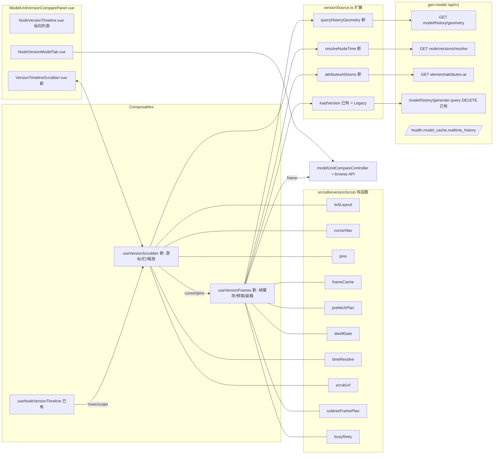
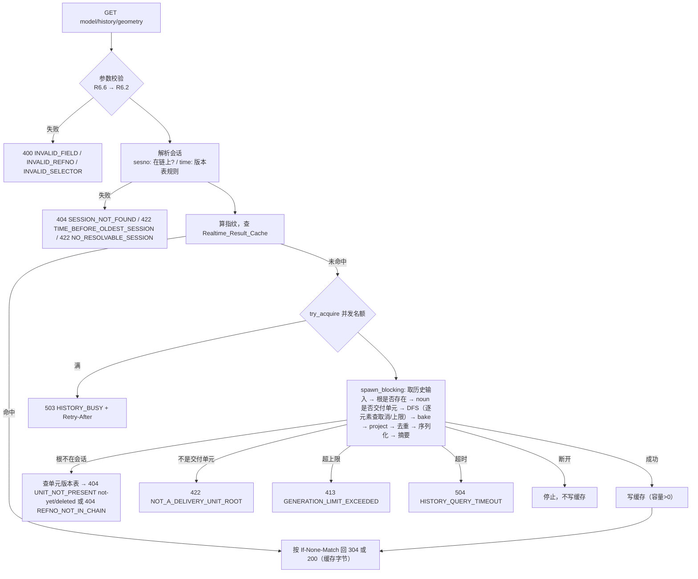
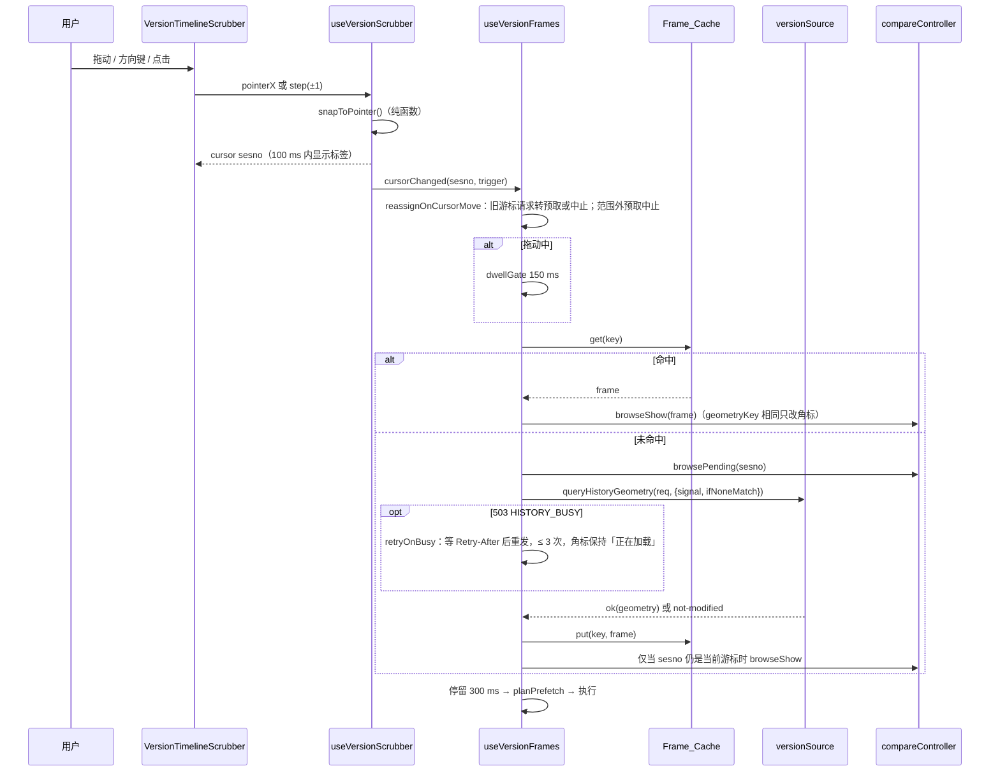
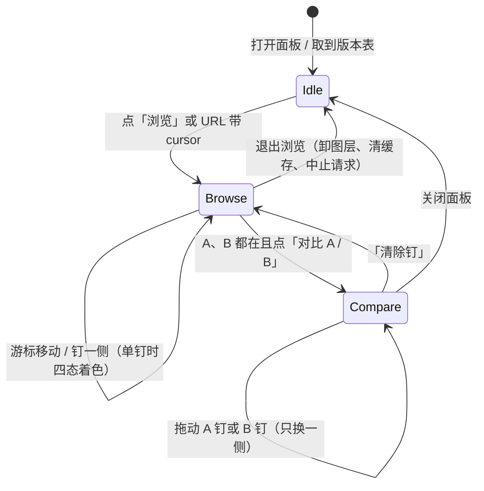

# Design Document：模型版本时间轴拖拽浏览（model-version-timeline-scrub）

## Overview

本设计在「节点版本」面板（ADR 0066）上加一条横向版本时间轴（Timeline_Scrubber）、单游标的「浏览」模式（Browse_Mode）、前端帧缓存与预取，以及「钉 A / 钉 B」快速对比。历史模型改为**同步实时查询**：前端发一次 `GET`，gen-model 在请求内由 e3d-model 按会话链算出该最小交付单元在该会话下的几何，同一个响应返回 `instances` 与 `tubes`。新路径没有生成任务、轮询、`snapshot_key`，也不往历史投影存储写任何东西。

后端还要补三样只读口：时间点解析（`node/versions/resolve`）、构件属性时点查询（`element/attributes-at`）、`/health.model_cache.realtime_history` 观测项。后端改动落在 gen-model `refactor` 分支，用 rocksdb 档（8022）在本地验证；发布部署不在本特性范围。

依据：`docs/adr/0066-compare-any-node-by-a-scope-toggle-and-fold-subtree-geometry-by-delivery-unit-summary-first.md`、`docs/guides/MODEL_VERSION_VIEW_TUTORIAL.md`、本目录 `requirements.md`。废弃的 `specs/004-model-version-timeline/` 不作依据。

### 调研结论（影响设计的事实）

后端（gen-model `refactor`，HEAD `d82cd90ce`）：

- `fast_model/historical_model.rs::generate_historical` 分两半。计算半：`E3dModelService::generate_snapshot_source(dbnum, root, sesno, policy)` → `GeneratedSnapshot { elements, owners, report, visited, .. }`。落库半：`apply_geometry_delta_on(ProjectionScope::Historical(key), …)` = `bake_elements(upserts, mesh_dir, None)`（三角化、算内容寻址 `mesh_id`、把网格文件写进共享网格目录）→ `project_geometry_delta(…, publication = None, owners)`（纯结构化，产出 `ProjectionCommit.upserts: Vec<ProjectedGeometry>`）→ `ModelMemoryStore::commit(Historical(key))`。之后 `history/query` 从该作用域取 `records` 再用 `instance_json` / `tube_json` 序列化。
- 所以实时路径只需：计算半 → `bake_elements` → `project_geometry_delta` → **直接**对 `commit.upserts` 调 `instance_json` / `tube_json`，跳过 `ModelMemoryStore::commit` 与 `HistoricalModelStore::publish`。`bake_elements` 与 `project_geometry_delta` 目前是 `e3d_model_service.rs` 内的私有函数，需要抽一个 `pub(crate) fn project_historical_records(…) -> Vec<ProjectedGeometry>` 供两条路共用（Legacy 路继续 commit，实时路直接序列化），这是 Requirement 6.15 等价性的结构保证。
- `instance_json` / `tube_json` 每行带 `snapshot_key` 字段与 `direct_model.sesno`（= `record.source_sesno`，即解析后的 sesno）。实时响应去掉 `snapshot_key`，保留其余字段原样。
- 投影存储按 `record_id` 存记录，同一 `record_id` 后写覆盖先写。实时路径序列化前要按同一规则对 `upserts` 去重（保留最后一条），否则与 Legacy 结果不等价。
- `generate_snapshot_source` 全程持有 `db_generation_lock(dbnum)`（与当前模型生成共用的每库互斥锁），并且在 async 上下文里同步跑 e3d-model DFS（不在 `spawn_blocking` 里）。若实时路径照搬，同一 dbnum 的实时查询会互相串行，还会排在当前模型生成后面；拖一个 BRAN 时全部请求都在同一个 dbnum 上，Realtime_Concurrency_Limit=4 实际退化为 1。
- 生成输入缓存 `generation_input(service, dbnum, sesno)` 以 `(dbnum, sesno, identity)` 为键，但**同一 dbnum 只留一份**（新 sesno 替换旧 sesno）。拖动时 sesno 不停变，每次都要 `scan_index` + `build_set` 重建，还会把当前模型用的那份（最新 sesno）挤掉。
- e3d-model（`../vendor/e3d-model`，path 依赖，可改）的 `pipeline::generate_subtree_with_cache` 是显式栈 DFS，每次 `stack.pop()` 处理一个元素，没有取消钩子。
- `MAX_HISTORY_ELEMENTS = 100_000` 现在是生成完才比 `report.visited`，超了才报 `GENERATION_LIMIT_EXCEEDED`。
- `SnapshotSourceError::RootNotInSession` 已能按类型区分「该会话没有这个根」；区分 `not-yet` / `deleted` 需要版本表。
- `source_fingerprint(path)` = SHA-256(路径, 文件长度, mtime 纳秒)，只覆盖设计库文件本身。
- 属性时点：`HistoricalModelStore::attributes_at` 实际只用到快照回执里的 `(source_file, sesno, dbnum)`，再走 `ElementAttributeService::open_pinned` + `read_pinned`。这段不依赖快照，可以直接按 `(dbnum, refno, sesno)` 调。
- 时间点：`select_session_at` 在**整条会话链**上从链头（sesno 最大）往回找第一条时刻 ≤ t 的会话。注释记录了 AvevaMarineSample 443 个库里 423 个的会话 1 时刻晚于其后整条链（最大倒退 13.6 年）。本特性的解析规则（Requirement 8.1）与它相同，只是输入换成**节点版本表**的行（版本表是会话链的子集）。设计把 `select_session_at` 的核心抽成对任意链序行序列都可用的泛型函数，会话链与版本表两种输入共用（§1.5）。
- 版本表：`unit_versions` / `node_versions`（进程内缓存 64 张表）行带 `sesno`、`session_time`、`impact_kind`；`impact_kind` 五态 `mesh | placement | delivery | noop | tombstone`。
- 配置惯例：`DbOption.toml` 字段 + `AIOS_*` 环境变量覆盖（`options::effective_count_limit`）。`/health.model_cache` 由 `handlers.rs::model_cache_health` 拼装。
- Web 框架是 axum 0.8（hyper 1）。

前端（plant3d-web）：

- `src/composables/useNodeVersionTimeline.ts` 已持有范围、A / B（`beforeSesno` / `afterSesno`）、「只看几何变的」（`geometryOnly`）和并表后的 `rows`。纯函数在 `src/utils/nodeVersionTimeline.ts`。新时间轴直接吃这份 `rows`，不另取数；`ModelNodeVersion` 行已带「动了几个单元」（Requirement 9.1）。
- `src/model-source/genModelV1/versionSource.ts` 的 `loadVersion` = generate → 500 ms 轮询 → `history/query instances + tubes` → `ModelVersionGeometry`；`release()` = `DELETE`。缺路由时抛 `ModelVersionRouteUnavailableError`。这条整体保留为 Legacy_History_Path。
- `src/utils/modelUnitCompareLoader.ts` 是「取两侧几何 → 比几何 → 拼 `open` detail」的唯一实现，已按 `geometryKey` 去重。
- `src/viewer/modelUnitCompareController.ts` 只有整轮 `open` / `clear`。
- URL 入口在 `src/utils/modelUnitVersionCompare.ts`，现有参数 `unit_refno`、`compare_a`、`compare_b`、`compare_autorun`。
- 仓库没有 `fast-check`，gen-model 没有 `proptest`，都要新增为开发依赖。

### 设计决策摘要

| 决策 | 选择 | 理由 |
|---|---|---|
| 实时几何怎么来 | 抽出 `project_historical_records`（bake + project），Legacy 与实时两路共用；实时路直接序列化 `upserts` | 同一段代码产出记录，Requirement 6.15 等价靠结构保证，集成测试只做确认 |
| 每库锁 | 实时路不拿 `db_generation_lock`，改用独立的 `realtime_compute_source`（同一计算，不加锁） | 只读会话钉死的源，写的只有内容寻址网格文件；拿锁会让同库并发退化为 1。网格文件并发写的安全性在阶段 1 先核实（见 Error Handling） |
| 生成输入 | 新建只给历史用的 `HistoricalInputLru`，键 `(dbnum, sesno, identity)`，缺省容量 4 | 不挤掉当前模型那份输入；来回拖动时相邻会话的输入可复用 |
| 取消 | `CancelToken(Arc<AtomicBool>)` + 计算放 `spawn_blocking`；e3d-model DFS 每弹出一个元素、bake 每处理一个元素查一次 | axum 丢弃 future 无法打断同步计算；只能协作式取消 |
| `geometryKey` | `g:` + 对规范化行（去 `snapshot_key`、去 `direct_model.sesno`、按 `(source_refno, id)` 排序）做 SHA-256 的前 16 字节 hex | 「仅属性」会话的行只差 sesno，要让它们摘要相同才能 304；摘要覆盖其余全部可见字段 |
| 结果缓存 | 进程内 LRU，存序列化后的响应体字节与头部，键 `(dbnum, unit, sesno, fingerprint)` | 命中与未命中逐字节一致（Requirement 7.3） |
| 源文件指纹 | 设计库文件指纹 + 当前 MDB 全部 pin 文件（含 CATA）的 (路径, 长度, mtime) 合并摘要，每次请求现算 | 几何还依赖目录库，只看设计库文件会漏掉目录改动 |
| 纯逻辑放哪 | 前端 `src/utils/versionScrub/` 纯 TS 模块，组合式函数只做响应式接线 | 与 `nodeVersionTimeline.ts` 现有分层一致，可做属性测试 |
| 时间轴排布 | 按 Chain_Order（sesno 升序）等距排布，横坐标只由 Tick_Ordinal 决定；Session_Time 只作次级标注、悬停与游标标签；时间倒退的会话打 Time_Anomaly_Marker | Session_Time 沿链不单调（会话 1 常晚于其后整条链），按时间排布会让刻度顺序、相邻版本与 A / B 先后都与会话链不一致（Requirement 1.2、1.3） |
| 顺序口径 | 游标移动、相邻版本、「最早 / 最新」、A / B 先后、链接回落一律按 sesno 比较，不看 Session_Time | 与排布一致，删掉了上一版的 `orderOf` 回调与 `'time' / 'sesno'` 双模式 |
| 时间点解析规则 | 链序规则：从 sesno 最大的行往前，跳过无时间行，取第一个 Session_Time ≤ t（秒级）。后端把 `select_session_at` 的核心泛化为 `select_latest_at`，会话链（Legacy `generate`）与版本表（`resolve` 路由、实时 `time` 选择器）共用；前端降级 `resolveAt` 实现同一规则，共享样例对拍 | 前端、后端、Legacy 三处结果一致（Requirement 8.1、8.10、10.2） |
| 时间点解析错误码 | 节点不存在 → 404 `NODE_NOT_FOUND`；范围内没有带时间的行 → 422 `NO_RESOLVABLE_SESSION`；全部晚于 t → 422 `TIME_BEFORE_OLDEST_SESSION` | Requirement 6.3、8.3、8.5、8.6 |
| refno 从未出现在会话链 | 404 `REFNO_NOT_IN_CHAIN`；前端不单列文案，按 Requirement 3.12 通用错误显示 | Requirement 6.5 |
| 游标请求遇 `HISTORY_BUSY` | 按 `Retry-After` 自动重发，最多 3 次，等待期间角标保持「正在加载」；与子树路径共用 `retryOnBusy`（§2.10） | Requirement 3.16、9.10 |
| 时间轴渲染 | SVG + 簇合并后渲染，游标只改 `transform` | 簇合并后可见元素 ≤ 轴宽 / 4 px（约 200 个）；拖动不触发刻度重排 |
| 浏览图层 | `modelUnitCompareController` 上加 `browse*` 方法，复用 A 侧隔离图层 | 不新造图层；进入 / 退出语义与 `open` / `clear` 对齐 |
| 旧服务端 | 实时路由缺失（404/405 且无错误码体）→ 本面板会话改走 Legacy_History_Path | 前后端可分开发布 |

### 已定事项（原「待确认」）

上一版列出的四项缺口已由需求修订关闭，并入上表：Requirement 8.5 / 8.6 的状态码、`REFNO_NOT_IN_CHAIN`、会话时间不单调时的排布与解析口径、游标请求的 `HISTORY_BUSY` 处理。

一处残留差别需要知道：Legacy `model/history/generate` 的 `time` 选择器在**整条会话链**上解析，实时路由与 `resolve` 路由在**单元版本表**上解析。会话时间不单调时，两者可能选中不同的会话。前端从不向 Legacy 路径传 `time`（总是先解析出 sesno 再请求），所以界面上不会出现这种差别；Requirement 6.15 的等价比较也只按 sesno 做。

### 分阶段交付

1. **阶段 1（gen-model `refactor`，后端）**：实时历史几何路由、时间点解析路由、属性时点路由、`/health` 观测项；在 rocksdb 档 8022 上用 `curl` 验证（命令见 Testing Strategy）。
2. **阶段 2（plant3d-web，前端）**：纯函数模块、Timeline_Scrubber、Browse_Mode、Frame_Cache 与预取（走实时路由）、钉 A / B、直达链接、Legacy 降级。纯函数模块与组件不依赖后端，可与阶段 1 并行；接线与联调在阶段 1 的路由可用后进行。
3. **阶段 3（联调与性能）**：rocksdb 档上按 Requirement 12 实测，记录命令、节点、sesno 序列、每次耗时。

## Architecture



### 后端实时查询内部流程



服务端超时与客户端断开都通过同一个 `CancelToken` 停止计算。并发名额（`OwnedSemaphorePermit`）随计算闭包一起移进阻塞线程，**在计算真正停下时**释放，所以 `/health` 报告的进行中计算数不会少算仍在占 CPU 的计算。

### 数据流：一次游标移动



### 状态机：面板显示模式



`Idle` 下面板保持 ADR 0066 现有行为（列表 + A / B 按钮 + 原「模型对比」）。

## Components and Interfaces

### 1. 后端 gen-model（`refactor` 分支）

#### 1.1 新路由

| 方法与路径 | 说明 |
|---|---|
| `GET /api/v1/model/history/geometry?dbnum=&unit_refno=&sesno=` 或 `&time=` | Realtime_History_Query。200 体为 History_Geometry_Response；支持 `If-None-Match` → 304。只读，不建任务、不写投影存储 |
| `GET /api/v1/node/versions/resolve?dbnum=&refno=&scope=self\|subtree&at=` | 时间点解析（Requirement 8）。200 `{ sesno, session_time }` |
| `GET /api/v1/element/attributes-at?dbnum=&refno=&sesno=` | 构件属性时点查询（Requirement 6.13）。200 体与现有 `tool=attributes` 相同，去掉 `snapshot_key` |

三条都挂在 `web_service/mod.rs` 现有 `/api/v1` 路由表上，项目身份参数沿用 `ProjectReq`（`#[serde(flatten)]`）。

#### 1.2 `fast_model/realtime_history.rs`（新模块）

```rust
pub struct RealtimeHistoryRequest {
    pub dbnum: u32,
    pub unit: RefNo,
    pub selector: RealtimeSelector,          // Sesno(u32) | At(DateTime<FixedOffset>)
    pub if_none_match: Vec<String>,          // 已去引号、去 W/ 前缀
}

pub enum RealtimeOutcome {
    Body(Arc<CachedHistoryResponse>),        // 200
    NotModified { sesno: u32, session_time: Option<String>, geometry_key: String }, // 304
}

pub struct CachedHistoryResponse {
    pub sesno: u32,
    pub session_time: Option<String>,
    pub geometry_key: String,
    pub body: bytes::Bytes,                  // 已序列化的 JSON
}

pub async fn query_realtime(req: RealtimeHistoryRequest, cancel: CancelToken)
    -> Result<RealtimeOutcome, HistoricalModelError>;
```

处理顺序（与 Requirement 6.16 的优先级一致，前一步失败不再做后一步）：

1. **字段校验（6.6）**：handler 用 `Option<String>` 接参数自己裁决，避免 axum `Query` 反序列化失败时给出 axum 默认 400 体。缺 `dbnum` / `unit_refno` → 400 `INVALID_FIELD`（`detail.field`）；refno 不是「两个正整数以 `_` 或 `/` 连接」或 `refno.dbno() != dbnum` → 400 `INVALID_REFNO`。
2. **选择器校验（6.2）**：`sesno` 与 `time` 恰好一个；`sesno` ∈ [1, 2³¹−1]；`time` 用 `parse_instant`（与前端同一语法，见 §2.7）。失败 400 `INVALID_SELECTOR`，`detail.params` 列出无效参数名（都带 / 都不带时为 `["sesno","time"]`）。
3. **会话解析（6.3、6.4）**：`sesno` 选择器：读会话链（`db_file_header::session_chain`，结果按 `(path, fingerprint)` 进程内缓存），不在链上 → 404 `SESSION_NOT_FOUND`。`time` 选择器：取该单元「仅自身」版本表（`unit_versions` 已缓存），用 `resolve_at_rows`（§1.5，链序规则）解析；没有带时间的行 → 422 `NO_RESOLVABLE_SESSION`；没有带时间的行满足 Session_Time ≤ t → 422 `TIME_BEFORE_OLDEST_SESSION`。解析后得到 `(sesno, session_time)`。
4. **指纹与缓存（7.2–7.4）**：`fingerprint = source_set_fingerprint()`（§1.4）。查 `RealtimeResultCache`。命中：若 `if_none_match` 含命中的 `geometry_key` → `NotModified`，否则 `Body`。命中时**不**占并发名额、不检查单元存在（缓存条目只会是 200，确定性保证同键结果相同）。命中数 +1。
5. **并发闸（7.1）**：`semaphore.clone().try_acquire_owned()`；失败 → 503 `HISTORY_BUSY`，`Retry-After` = `clamp(1 + in_flight / limit, 1, 5)` 秒，不计命中 / 未命中。成功则未命中数 +1。
6. **计算（spawn_blocking）**：闭包持有 permit 与 `CancelToken`：
   1. `HistoricalInputLru::get_or_build(dbnum, sesno)`（§1.3）。
   2. 根不在 `input.index.owners` → 走 §1.6 判 `UNIT_NOT_PRESENT` / `REFNO_NOT_IN_CHAIN`。
   3. 根的 noun 不在项目 `delivery_unit_types` → 422 `NOT_A_DELIVERY_UNIT_ROOT`（复用 Legacy handler 现有判定函数）。
   4. `e3d_model::pipeline::generate_subtree_with_hooks(root, cache, &hooks)`：`hooks.should_stop()` 每弹出一个元素调用一次，返回 `Stop::Cancelled` 或 `Stop::LimitExceeded`（`visited > MAX_HISTORY_ELEMENTS`，6.8 在计算中途停）。
   5. `project_historical_records(dbnum, sesno, elements, &owners, mesh_dir, &cancel)`：bake 每个元素前查一次取消。
   6. 按 `record_id` 去重（保留最后一条，与投影存储覆盖语义一致），按 `(source_refno, record_id)` 排序，`instance_json` / `tube_json` 序列化并删去 `snapshot_key` 键。
   7. `geometry_key = geometry_digest(&instances, &tubes)`（§1.4）。
   8. 拼 `{ dbnum, unit_refno, sesno, session_time, geometryKey, instances, tubes, stats: { visited, generated, failed, elapsed_ms } }` 序列化为 `Bytes`。
7. **超时（6.9）**：`tokio::time::timeout(history_query_timeout(), join_handle)`；超时 → `cancel.cancel()`，回 504 `HISTORY_QUERY_TIMEOUT`，阻塞线程在下一个检查点退出并释放 permit。
8. **写缓存**：仅当结果为 200、`cancel` 未触发、容量 > 0。`If-None-Match` 命中则回 304（7.7），否则 200（7.8）。

`GeometryFailurePolicy`：与 Legacy 前端调用一致取 `BestEffort`（部分元素失败照常返回，失败数放 `stats.failed`），否则两路结果不等价。

**响应头**：200 与 304 都带 `ETag: "<geometryKey>"`、`X-Sesno: <sesno>`、`X-Session-Time: <RFC3339>`（会话无时间时值为空字符串）、`Cache-Control: no-cache`。CORS 配置要在 `Access-Control-Expose-Headers` 里加 `ETag, X-Sesno, X-Session-Time, Retry-After`，否则浏览器端读不到。

**断开取消（6.14）**：handler 内创建 `CancelToken` 和一个 `CancelOnDrop(token.clone())` guard。hyper 在检测到连接关闭时丢弃 handler future，guard 的 `Drop` 置位 token。可达到的粒度：

- DFS 与 bake 阶段：一个元素的求值 / 三角化。普通构件为毫秒级；复杂 CSG 单件可能数百毫秒。这一段能满足 2 s。
- 取历史输入阶段（`scan_index` + `build_set`，冷启动时对大库可达数秒）**不可中断**。冷输入阶段遇到断开时，计算会在输入建完后的第一个检查点停下，可能超过 2 s。建好的输入留在 `HistoricalInputLru` 里，下一次请求直接用。
- hyper 1 对 HTTP/1 进行中请求的断开检测依赖连接读端看到 EOF；阶段 1 用 `curl --max-time 1` 实测 `in_flight` 回落时间并记入验证记录。若检测不到，退化为由服务端超时（缺省 60 s）兜底，Requirement 6.14 判为不通过并回报。

#### 1.3 实时计算源与历史输入缓存

- `E3dModelService::realtime_compute_source(&self, dbnum, root, sesno, policy, hooks) -> Result<GeneratedSnapshot, RealtimeComputeError>`：与 `generate_snapshot_source` 相同的计算，但**不拿** `db_generation_lock`，输入取自 `HistoricalInputLru` 而不是 `generation_input`，DFS 走带钩子的版本。`generate_snapshot_source` 改为调用同一个内部函数（钩子为空、输入走原缓存、外面套锁），保证两路求值代码一致。
- `HistoricalInputLru`：键 `(dbnum, sesno, identity)`，容量 `model_history_input_max`（`DbOption.toml` + `AIOS_MODEL_HISTORY_INPUT_MAX`，缺省 4，0 = 停用缓存每次现建）。按最近使用淘汰。同键并发构建用 `DashMap<Key, Arc<OnceCell<GenerationInput>>>` 合并成一次。`/health` 报告条数与容量。内存估算沿用 `element_cache_stats`。
- e3d-model 新增：

```rust
pub enum Stop { Cancelled, LimitExceeded }
pub trait GenerationHooks { fn should_stop(&self, visited: usize) -> Option<Stop>; }
pub fn generate_subtree_with_hooks(root: DbElement, cache: &mut CatalogueMeshCache, hooks: &dyn GenerationHooks)
    -> Result<GenerationOutcome, GenerationStopped>;
```

`generate_subtree_with_cache` 改为以空钩子调用它，行为不变。

#### 1.4 摘要与指纹

- `geometry_digest(instances, tubes)`：把每行 JSON 去掉 `snapshot_key` 与 `direct_model.sesno`，用 `serde_json` 规范化输出（键按字典序，`serde_json::Value` 的 `Map` 开 `preserve_order` 时需先转 `BTreeMap`），按 `(kind, source_refno, id)` 排序后逐行 `kind \0 json \n` 喂进 SHA-256，取前 16 字节 hex，前缀 `g:`。空单元（实例与管段都空）也按同一算法，得到一个固定值。
  - 摘要只排除随会话号变化、但不影响三维显示的字段，所以「仅属性」会话与前一版摘要相同，可以 304。
  - 128 位截断的碰撞概率可忽略；Requirement 6.11 的「当且仅当」在此前提下成立。
- `source_set_fingerprint()`：SHA-256( `source_fingerprint(设计库文件)` ‖ 当前 MDB 全部 pin 按 `(dbnum, path)` 排序后的 (路径, 长度, mtime) )。每次请求现算（只读文件元数据，数百个文件在毫秒级）；可以按 1 s TTL 记住结果，避免同一秒内重复 stat。

#### 1.5 时间点解析（`fast_model/time_resolve.rs`，新）

```rust
pub struct VersionInstant { pub sesno: u32, pub session_time: Option<String> }
pub enum ResolveError { InvalidFormat, BeforeOldest, NoResolvable }

/// select_session_at 的泛化核心。`items` 按 Chain_Order（sesno 升序）给出。
pub enum SelectAt<'a, T> { Found(&'a T), BeforeOldest, NoTimed }
pub fn select_latest_at<'a, T>(
    items: &'a [T],
    time_of: impl Fn(&T) -> Option<DateTime<FixedOffset>>,
    at: DateTime<FixedOffset>,
) -> SelectAt<'a, T>;

pub fn parse_instant(text: &str, fallback_offset: Option<FixedOffset>) -> Option<DateTime<FixedOffset>>;
pub fn resolve_at_rows(rows: &[VersionInstant], at: &str) -> Result<(u32, String), ResolveError>;
```

规则（Requirement 8.1–8.3、8.6，与前端 §2.7 同一规则）：

1. 从 `items` 末尾（sesno 最大）往前逐行检查，跳过没有 Session_Time 的行。
2. 双方截到秒后比较，返回第一个 Session_Time ≤ t 的行。结果是「带时间且 ≤ t 的行中 sesno 最大者」，不一定是时间最接近 t 的行；同秒的多行自然取 sesno 最大（8.2）。
3. 一行带时间的都没有 → `NoTimed`（`NoResolvable`）；有带时间的行但都晚于 t → `BeforeOldest`。
4. 不带偏移的 `at` 按 Session_Time 所用时区解释：取 Chain_Order 中第一条带时间行的偏移；都没有时间时直接是 `NoResolvable`，不需要偏移。

改造方式：现有 `select_session_at(chain, at)` 改为 `select_latest_at(&chain.sessions, |s| s.time, at)` 的薄包装，Legacy `generate` 的行为不变；`resolve_at_rows` 是对版本表行的同一调用。阶段 1 先读一遍现有 `select_session_at`，确认它的比较精度（是否截秒）与无偏移时间的解释方式；与上面第 2、4 点不一致时以现有实现为准，同步修改前端 `timeResolve.ts` 与共享样例，保证三处一致。

`node/versions/resolve` handler：参数校验（`scope` 只能 `self` / `subtree`、`at` 合法，否则 400 `INVALID_SELECTOR`）→ 节点不存在 → 404 `NODE_NOT_FOUND`（8.5）→ `node_versions(dbnum, refno, scope, None, Some(5000))` 取全表（同一缓存）→ `resolve_at_rows`。`NoResolvable` → 422 `NO_RESOLVABLE_SESSION`（8.6）；`BeforeOldest` → 422 `TIME_BEFORE_OLDEST_SESSION`（8.3）。版本表超过 5000 行被截断时按 `since_sesno` 翻页取全，再解析（链序规则从 sesno 最大往前找，截断会丢掉最新的行，所以必须取全）。

实时几何路由的 `time` 选择器调用同一个 `resolve_at_rows`，输入是该单元的 `unit_versions` 版本表（按单元子树折叠：子树里任一成员变化也算这个单元的一版），所以 Requirement 8.10 的一致性由同一函数同一输入保证——**对照口径是 `node/versions?scope=subtree`**。

注意（阶段 3 实测更正）：本文件早先写的「`unit_versions` 与 `node_versions(scope=self)` 对单元根相同」不成立。对交付单元根 `24384/23257`（73 个版本）：`unit_versions` **73 行**，`node_versions(scope=self)` **5 行**（只算单元根自己那条记录的变化），`node_versions(scope=subtree)` **73 行**。所以 `geometry(time)` 与 `resolve(scope=subtree)` 给同一个 sesno（实测均为 419），与 `resolve(scope=self)` 必然不同（283）。R8.10 已按此改写为「所有子节点」口径，证据见 `docs/verification/model-version-timeline-scrub/finding-r6-3-vs-r8-10.md`。

共享样例 `docs/fixtures/version-time-resolve-cases.json`：每条为 `{ rows: [{ sesno, session_time|null }], at, expect: { sesno, session_time } | { error } }`。必须包含：会话 1 的时间晚于其后全部会话（AvevaMarineSample 形态）、中间一段时间倒退、同秒多行、无偏移时间点、全部无时间、t 早于全部带时间行、t 恰等于某行 v 的时间、但 sesno 更大的某行时间不晚于 v（往返结果 w ≠ v 的情形）。Rust 与 TS 各一个例子测试读它对拍，`select_session_at` 的包装另用其中几条做回归。

#### 1.6 单元不存在的判定

根不在该会话的元素索引时，取该单元「仅自身」版本表（链序）：

- 表为空（refno 在链上任何会话都没有记录）→ 404 `REFNO_NOT_IN_CHAIN`。
- 在链序中找请求会话之前（含）的最后一行 `r`：不存在 → `UNIT_NOT_PRESENT`，`reason: "not-yet"`；`r.impact_kind == tombstone` → `reason: "deleted"`。
- 找到的行不是 tombstone 但索引里没有根（数据不一致）→ 500 `GEOMETRY_GENERATION_FAILED`，消息写明不一致。

纯函数 `classify_absent(rows_in_chain_order, chain_index_of_requested) -> AbsentKind` 单独测试。

#### 1.7 属性时点（`element/attributes-at`）

把 `attributes_at` 的阻塞段抽成 `read_attributes_at(dbnum, source_file, sesno, refno, service)`，不经过快照回执。错误：refno 格式错 → 400 `INVALID_REFNO`；sesno 不在链上 → 404 `SESSION_NOT_FOUND`；构件在该会话不存在 → 404 `REFNO_NOT_FOUND_AT_SESSION`。Legacy `tool=attributes` 改为调用同一函数，保留其 `exists: false` 语义。

#### 1.8 配置与 `/health`

| 配置（`DbOption.toml` / 环境变量） | 范围 | 缺省 |
|---|---|---|
| `model_history_realtime_concurrency` / `AIOS_MODEL_HISTORY_REALTIME_CONCURRENCY` | 1–64 | 4 |
| `model_history_realtime_cache` / `AIOS_MODEL_HISTORY_REALTIME_CACHE` | 0–1024（0 = 停用） | 32 |
| `model_history_query_timeout_secs` / `AIOS_MODEL_HISTORY_QUERY_TIMEOUT_SECS` | 1–600 | 60 |
| `model_history_input_max` / `AIOS_MODEL_HISTORY_INPUT_MAX` | 0–64 | 4 |

越界值在启动时回落缺省并 `log::warn!` 一行（Requirement 6.9），与现有 `effective_count_limit`「0 = 不限」语义不同，所以用新的 `bounded_setting(raw, min, max, default)`。

`/health.model_cache.realtime_history`：

```json
{
  "cache_entries": 3, "cache_capacity": 32,
  "hits_total": 10, "misses_total": 7,
  "in_flight": 1, "concurrency_limit": 4,
  "input_cache": { "entries": 2, "capacity": 4 },
  "timeout_secs": 60
}
```

`cache_entries` 只数当前指纹下的条目（7.4）：指纹变化时整表清空（每个条目键里有指纹，但同一 `(dbnum, unit)` 只可能有一个当前指纹，直接清比按键过滤简单）。`in_flight` = `limit − semaphore.available_permits()`。`historical` 分项不变；实时路径不触碰 `HistoricalModelStore`，`snapshots` 不受影响（6.12）。

### 2. 前端纯函数模块 `src/utils/versionScrub/`

全部无 Vue、无 DOM、无网络依赖。

#### 2.1 `tickLayout.ts`：刻度排布、簇合并、缩放

```ts
export type ScrubVersion = {
  sesno: number;
  sessionTime: string | null;      // RFC3339
  impactKind: ModelVersionImpactKind | null;
  author?: string | null;
  note?: string | null;
  changedUnits?: number | null;    // 仅「所有子节点」范围
};
/** 视口以 Tick_Ordinal 计（浮点），刻度 i 的中心在 i，全量范围为 [-0.5, n - 0.5]。 */
export type OrdinalViewport = { start: number; end: number };
export type LaidTick = { sesno: number; ordinal: number; x: number };
export type TickCluster = { x: number; sesnos: number[]; first: number; last: number; anomaly: boolean };
export type TimeLabel = { sesno: number; x: number; text: string };   // 次级时间标注

export function orderVersions(versions: readonly ScrubVersion[]): ScrubVersion[];   // sesno 升序
export function fullViewport(n: number): OrdinalViewport;                            // [-0.5, n - 0.5]
export function minSpanOf(n: number): number;                                        // min(5, n)
export function timeAnomalies(ordered: readonly ScrubVersion[]): Map<number, number>; // 异常 sesno → 前一个带时间版本的 sesno
export function layoutTicks(input: {
  ordered: readonly ScrubVersion[]; viewport: OrdinalViewport; widthPx: number;
  anomalies: ReadonlyMap<number, number>; minGapPx?: number;
}): { ticks: LaidTick[]; clusters: TickCluster[]; gapPx: number };
export function timeLabels(ticks: readonly LaidTick[], versions: ReadonlyMap<number, ScrubVersion>,
  widthPx: number, minLabelGapPx?: number): TimeLabel[];
export function ghostOrdinal(orderedSesnos: readonly number[], sesno: number): number; // 不在表中的 sesno 的灰标位置
export function zoomViewport(viewport: OrdinalViewport, anchorOrdinal: number, factor: number, n: number): OrdinalViewport;
export function viewportForCluster(cluster: TickCluster, orderedSesnos: readonly number[], widthPx: number,
  minGapPx?: number): OrdinalViewport;
export function impactPalette(kinds: readonly ModelVersionImpactKind[]): Map<ModelVersionImpactKind, { color: string; hollow: boolean }>;
```

- **排布（Requirement 1.2）**：`orderVersions` 只按 sesno 升序，下标即 Tick_Ordinal。`x = (ordinal − start) / (end − start) × widthPx`，与 Session_Time 无关。上一版的 `'time' / 'sesno'` 双模式与 `axisModeOf` 删除。
- **时间异常（Requirement 1.3）**：`timeAnomalies` 沿 Chain_Order 扫一遍，记住「前一个带时间版本」；当前版本带时间且秒级时间严格早于它时，记 `当前 sesno → 前一版 sesno`。无时间的行既不标记，也不更新「前一个带时间版本」。悬停提示用这张表取前一版的 sesno 与时间。
- **簇（Requirement 1.7）**：等距排布下相邻刻度间距处处相同（`gapPx = widthPx / (end − start)`），不能用「连续一段间距 < 4 px 就合并」，否则整条轴会并成一簇。改为按序号分桶：`k = gapPx ≥ minGapPx ? 1 : ceil(minGapPx / gapPx)`，序号 `i` 归入桶 `floor(i / k)`（以序号 0 对齐，平移视口时簇的成员不变）；簇的 x 取桶的名义中心（序号 `b × k + (k − 1) / 2` 处，末桶不满时也用名义中心，超出轴两端的部分由 SVG 裁掉），相邻簇中心恰好相距 `k × gapPx ≥ 4 px`。只为视口内（含两端各一桶）的刻度出簇。簇内任一刻度在 `anomalies` 中时 `anomaly = true`。
- **次级时间标注**：`timeLabels` 在可见刻度中每隔 `ceil(minLabelGapPx / max(gapPx, k × gapPx))` 个序号取一个（缺省 `minLabelGapPx = 80`），标该刻度的日期（`YYYY-MM-DD`，同一天内的相邻标注改用 `HH:mm`）；无时间的刻度跳过、顺延到下一个带时间的刻度。标注只是读数，不表示刻度按时间分布，异常刻度的标注与刻度同用异常色。
- **灰标（Requirement 1.10）**：`ghostOrdinal` 找 sesno 在表中的插入位置 `p`（小于它的刻度数），返回 `p − 0.5`，即落在「sesno 小于它的最后一个刻度」与「sesno 大于它的第一个刻度」之间；比全表都小时为 `−0.5`，比全表都大时为 `n − 0.5`。
- **缩放（Requirement 1.8）**：以 `anchorOrdinal`（指针 x 反算的序号）为中心把跨度乘 `factor`，跨度钳在 `[minSpanOf(n), n]`，再平移进 `fullViewport(n)`。未触及限制时锚点的相对位置不变。缩放后 `layoutTicks` 重新分桶，间距达到 4 px 的簇自然展开。
- **点击簇（Requirement 1.13）**：`viewportForCluster` 取 `[first 的序号 − 0.5, last 的序号 + 0.5]`，若跨度小于 `minSpanOf(n)` 则以簇中心扩到下限，再钳进全量范围。结果下要么簇内刻度间距 ≥ 4 px，要么跨度等于下限。
- `impactPalette`：五态各有固定色（沿用面板现有徽章色），`noop` 空心。

#### 2.2 `cursorNav.ts`：游标吸附与移动

```ts
export function isGeometryChange(kind: ModelVersionImpactKind | null): boolean; // kind !== null && kind !== 'noop'
export function navigableTicks(ticks: readonly LaidTick[], versions: ReadonlyMap<number, ScrubVersion>, geometryOnly: boolean): LaidTick[];
export function snapToPointer(candidates: readonly LaidTick[], pointerX: number): number | null;
export function stepCursor(candidates: readonly LaidTick[], current: number, delta: -1 | 1): number;
export function clickTick(candidates: readonly LaidTick[], clicked: TickCluster, current: number): number;
export function initialCursor(candidates: readonly LaidTick[]): number | null; // sesno 最大
export function coerceCursorForGeometryOnly(all: readonly ScrubVersion[], current: number): number | null;
```

候选刻度一律按 Tick_Ordinal（即 sesno）升序给出，「相邻」「第一个 / 最后一个」都按这个顺序（Requirement 2.3、2.5）。`noop` 视为「仅属性」，其余四态（含 `tombstone`）视为几何变化。`snapToPointer` 取水平距离最小者，并列取 sesno 较大者，候选为空回 null。`stepCursor` 到端点不动。`coerceCursorForGeometryOnly`：sesno ≤ 当前的最后一个几何变化版本，没有则 sesno 最小的几何变化版本，都没有回 null。

#### 2.3 `pins.ts`：钉住与排序

```ts
export type Pins = { a: number | null; b: number | null };
export function pinSide(pins: Pins, side: 'a' | 'b', sesno: number):
  { pins: Pins; rejected: null | 'same-version' };
export function normalizePins(pins: Pins): Pins; // a > b（按 sesno）时交换
export function pinsWithPrevious(orderedSesnos: readonly number[], cursor: number): Pins | null;
export function pinsWithLatest(orderedSesnos: readonly number[], cursor: number): Pins | null;
```

先后只按 sesno 比较，不看 Session_Time（Requirement 5.2）；`orderedSesnos` 是当前范围版本表的 sesno 升序列，「上一版」是其中游标前一项，「最新」是末项（5.10–5.12）。Pinned_Version 写回 `useNodeVersionTimeline` 的 `beforeSesno` / `afterSesno`，「属性对比」「差异摘要」两个 tab 不改取数入口（5.9）；允许只有一侧，此时 `pairReady` 为 false，「对比 A / B」禁用。

#### 2.4 `frameCache.ts`：LRU + 几何共享

```ts
export type FrameKey = string; // `${dbnum}|${unitRefno}|${sesno}`
export function frameKeyOf(dbnum: number, unitRefno: string, sesno: number): FrameKey;

export type CachedFrame<G> = {
  key: FrameKey; dbnum: number; unitRefno: string; sesno: number; sessionTime: string | null;
  geometryKey: string | null;
  geometry: G;
  legacySnapshotKey?: string | null;   // 仅 Legacy 降级路径产生
};
export type ProtectSet = { keys: ReadonlySet<FrameKey>; cursorSesno: number | null };
export type FrameCacheEffect<G> =
  | { kind: 'evicted'; frame: CachedFrame<G> }      // 调用方据 legacySnapshotKey 决定是否 DELETE
  | { kind: 'free-geometry'; geometry: G };

export function emptyFrameCache<G>(): FrameCacheState<G>;
export function getFrame<G>(s: FrameCacheState<G>, key: FrameKey): CachedFrame<G> | null;
export function putFrame<G>(s, frame: CachedFrame<G>, protect: ProtectSet, limit?: number): { state; effects };
export function putSharedFrame<G>(s, meta: Omit<CachedFrame<G>, 'geometry'>, sharedFrom: FrameKey, protect, limit?): { state; effects }; // 304
export function touchFrame<G>(s, key: FrameKey): FrameCacheState<G>;
export function trimFrames<G>(s, protect: ProtectSet, limit?: number): { state; effects };
export function clearFrames<G>(s): { state; effects };
```

规则（Requirement 4.1、4.2、4.7、4.10）：

- `limit` 缺省 12，按键计。超限时从最久未使用端找第一个不在 `protect.keys` 且 `sesno !== cursorSesno` 的键淘汰；找不到再找不在 `protect.keys` 的；仍找不到则暂时超限（子树「全部加载」）。`cursorSesno` 改变后调用 `trimFrames` 收回到 12。
- 几何按 `geometryKey` 引用计数共享。同 `geometryKey` 第二次 `putFrame` 丢弃传入的几何（产出 `free-geometry`），复用已有份；`putSharedFrame` 直接引用 `sharedFrom` 那份并 +1。引用归 0 才产出 `free-geometry`。无 `geometryKey` 的帧独占几何。
- 纯函数只产出副作用清单；执行（释放图层几何、Legacy 下 `DELETE` 快照）由 `useVersionFrames` 做。

#### 2.5 `prefetchPlan.ts`：预取计划与请求重分配

```ts
export type PrefetchInput = {
  ordered: readonly number[];          // 可导航 sesno，升序（Chain_Order）
  cursor: number;
  cached: ReadonlySet<number>;
  inFlight: ReadonlySet<number>;       // 游标请求 + 预取请求
  failed: ReadonlySet<number>;         // 本会话预取失败过的（HISTORY_BUSY 不进此集合）
  excluded?: ReadonlySet<number>;      // 子树范围下 Changed_Unit > 5 的版本
  cursorRequestActive: boolean;
  activePrefetches: number;
  radius?: number;                     // 缺省 2
  maxConcurrent?: number;              // 缺省 2
};
export function prefetchCandidates(input: PrefetchInput): number[];
export function planPrefetch(input: PrefetchInput): number[];

export type InFlight = { sesno: number; role: 'cursor' | 'prefetch' };
export function reassignOnCursorMove(input: {
  ordered: readonly number[]; newCursor: number; inFlight: readonly InFlight[];
  queuedPrefetch: readonly number[]; radius?: number; maxConcurrent?: number;
}): { convertToPrefetch: number[]; abort: number[]; dequeue: number[] };
```

- 候选：从游标往外按距离 1、2 取，同距离先前后后；跳过 cached / inFlight / failed / excluded；某侧到头只取另一侧现有的。
- `planPrefetch`：`cursorRequestActive` 为真时返回空；否则取前 `maxConcurrent − activePrefetches` 个。
- `reassignOnCursorMove`（Requirement 3.15、4.8）：
  - 旧游标请求（`role: 'cursor'` 且 sesno ≠ 新游标）：若在新游标 ±radius 内且「范围内保留的预取数 + 已转换数 < maxConcurrent」→ `convertToPrefetch`，否则 `abort`。
  - 进行中预取：不在 ±radius 内 → `abort`。
  - 排队中预取：不在 ±radius 内 → `dequeue`。
  - 被中止 / 移出队列的不标失败。旧游标请求恰好等于新游标时保持为游标请求。

#### 2.6 `dwellGate.ts`：停留门

```ts
export function createDwellGate(opts: {
  delayMs: number; fire: (sesno: number) => void; schedule: (fn: () => void, ms: number) => () => void;
}): { onSnap(sesno: number): void; flush(sesno: number): void; dispose(): void };
```

拖动时每次吸附到新刻度重启计时，连续 `delayMs` 停在同一刻度才 `fire`。松开 / 点击 / 方向键调 `flush`，立即触发并取消计时。两个实例：150 ms（游标请求，3.3）与 300 ms（预取，4.3）。`schedule` 注入，测试用假时钟。

#### 2.7 `timeResolve.ts`：时间点解析（前端降级用，与后端同一规则）

```ts
export type ResolveError = 'invalid-format' | 'before-oldest' | 'no-resolvable';
export function parseInstant(text: string, fallbackOffsetMinutes: number | null): number | null; // epoch ms，截到秒
export function resolveAt(versions: readonly ScrubVersion[], text: string):
  | { ok: true; sesno: number; sessionTime: string } | { ok: false; error: ResolveError };
```

语法：`YYYY-MM-DD[T| ]HH:mm[:ss[.fff]][Z|±HH:MM]`。`resolveAt` 先按 sesno 升序排好输入，再执行 §1.5 的链序规则：从 sesno 最大的行往前，跳过无时间行，返回第一个秒级 Session_Time ≤ t 的行；一行带时间的都没有 → `no-resolvable`；有但都晚于 t → `before-oldest`；无偏移时间点用 Chain_Order 中第一条带时间行的偏移解释。输入只用当前 Compare_Scope 已取回的版本表（Requirement 10.2）；版本表还有未加载的更早页不影响结果（规则从最新往前找，更早的页只在已加载的带时间行都晚于 t、或已加载行都没有时间时才可能命中，此时先按 `since_sesno` 补齐再解析）。前后端用 `docs/fixtures/version-time-resolve-cases.json` 对拍（§1.5）。

界面错误文案（Requirement 8.9、10.2）：`invalid-format` →「时间格式无效」，`before-oldest` →「早于最早版本」，`no-resolvable` →「没有可解析的版本」，后端 `NODE_NOT_FOUND` →「节点不存在」。

#### 2.8 `scrubUrl.ts`：直达链接编解码

```ts
export type ScrubUrlState = { unitRefno: string; scope: 'self' | 'subtree'; cursor: number; a: number | null; b: number | null };
export function writeScrubUrl(href: string, state: ScrubUrlState): string;
export function readScrubUrl(search: string):
  | { kind: 'none' }
  | { kind: 'ok'; unitRefno: string; scope: 'self' | 'subtree' | null; cursor: number; rawA: string | null; rawB: string | null }
  | { kind: 'invalid'; param: 'unit_refno' | 'scope' | 'cursor'; raw: string; unitRefno: string | null };
export function reconcileScrubState(parsed, orderedSesnos: readonly number[]):
  { cursor: number; pins: Pins; notices: string[] };
```

- 写：`unit_refno`（`/` 规整为 `_`）、`scope`、`cursor`；有钉才写 `compare_a` / `compare_b`；删掉 `compare_autorun`（`cursor` 本身表示自动进入浏览）；其余参数原样保留。
- 读：没有 `cursor` → `none`，走现有 `compare_*` 逻辑。`cursor` 必须是正整数，`scope` 只能 `self` / `subtree`。
- `reconcileScrubState` 负责 Requirement 11.2（交换）、11.3、11.7、11.8，全部按 sesno 比较：cursor 回落到 sesno ≤ 它的最后一版，没有则 sesno 最小的一版；钉非整数或不在表中 → 忽略并提示；A = B 只留 A；A 的 sesno 大于 B 时交换。

#### 2.9 `subtreeFramePlan.ts`：子树范围的单元装载计划

```ts
export type SubtreeUnitChange = { unitRefno: string; changedElements: number };
export type SubtreePlan =
  | { kind: 'latest' }
  | { kind: 'load'; units: SubtreeUnitChange[] }
  | { kind: 'confirm'; units: SubtreeUnitChange[]; top: SubtreeUnitChange[] };

export function planSubtreeFrames(input: {
  cursor: number; latest: number;
  groups: readonly SubtreeUnitChange[];   // node/diff-summary(cursor, latest) 中几何有变化的单元
  cachedUnits: ReadonlySet<string>;
  costThreshold: number | null;           // diffSummary.confirmThresholdUnits
  hardLimit?: number;                     // 缺省 20
}): SubtreePlan;

export function runBounded<T>(tasks: readonly (() => Promise<T>)[], limit: number): Promise<PromiseSettledResult<T>[]>;
```

需要查询数 = 未缓存的单元数；超过 `costThreshold` 或 20 → `confirm`，`top` 为按 `changedElements` 降序、同数 refno 升序的前 20 个；否则 `load`。`runBounded` 保证同时进行的请求不超过 `limit`（取 `/health.model_cache.realtime_history.concurrency_limit`，未取得按 4，Requirement 9.9）。每个任务内部用 §2.10 的 `retryOnBusy` 包住请求（9.10），一个名额在重试等待期间仍被该任务占着，不让排队任务插进来加剧拥塞。

#### 2.10 `busyRetry.ts`：`HISTORY_BUSY` 重试（游标请求与子树请求共用）

```ts
export type BusyRetryOptions = {
  maxRetries?: number;                                    // 缺省 3
  sleep: (ms: number, signal: AbortSignal) => Promise<void>; // 注入，测试用假时钟；signal 触发时 reject AbortError
  signal: AbortSignal;
  shouldRetry?: () => boolean;                            // 每次准备重发前询问；返回 false 时以最后一次 HISTORY_BUSY 结束
  onWait?: (attempt: number, delayMs: number) => void;    // 角标保持「正在加载」用
};
export function retryOnBusy<T>(run: (signal: AbortSignal) => Promise<T>, opts: BusyRetryOptions): Promise<T>;
export function retryAfterMs(err: HistoryQueryError): number; // Retry-After 秒钳到 [1, 5] 后 ×1000；缺头按 1 s
```

- 首次调用 `run`；结果是 `HistoryQueryError(code = 'HISTORY_BUSY')` 时等 `retryAfterMs` 再调，最多再调 `maxRetries` 次（合计 ≤ 4 次）。第 4 次仍忙时抛出该 `HISTORY_BUSY` 错误，调用方据此标失败（Requirement 3.16 → 3.12，9.10 → 9.8）。
- 其他错误与成功结果原样返回，不重试。
- `signal` 在等待或请求中触发时，立即以 `AbortError` 结束，之后不再调用 `run`；调用方识别 `AbortError` 后不标失败。
- `shouldRetry` 让游标请求在被 `reassignOnCursorMove` 转为预取后停止自动重试：预取遇忙按 Requirement 4.11 处理（不标失败、下次 300 ms 停留时重新计划），不继续占预取名额。

### 3. 版本来源端口扩展（`ports.ts` / `versionSource.ts` / `genModelV1Api.ts`）

```ts
export type HistoryGeometryRequest = { dbnum: number; unitRefno: string } & ({ sesno: number } | { time: string });
export type HistoryGeometryResult =
  | { kind: 'ok'; sesno: number; sessionTime: string | null; geometryKey: string; geometry: ModelVersionGeometry }
  | { kind: 'not-modified'; sesno: number; sessionTime: string | null; geometryKey: string };

export class HistoryQueryError extends Error {
  code: string;                 // UNIT_NOT_PRESENT / HISTORY_BUSY / HISTORY_QUERY_TIMEOUT / NETWORK / CLIENT_TIMEOUT …
  status: number | null;
  reason?: 'not-yet' | 'deleted';
  retryAfterMs?: number;
}

export type ModelVersionSource = {
  // ……已有（listVersions / loadVersion / attributesAt / release …）
  queryHistoryGeometry?(req: HistoryGeometryRequest, opts: { signal: AbortSignal; ifNoneMatch?: string; timeoutMs?: number }): Promise<HistoryGeometryResult>;
  attributesAtSesno?(req: { dbnum: number; refno: string; sesno: number }, opts?: { signal?: AbortSignal }): Promise<ModelElementAttributes>;
  resolveNodeTime?(req: { dbnum: number; refno: string; scope: ModelNodeDiffScope; at: string }): Promise<{ sesno: number; sessionTime: string }>;
  readRealtimeLimit?(): Promise<number | null>;   // 读 /health.model_cache.realtime_history.concurrency_limit
};
```

- `queryHistoryGeometry`：`fetch(url, { signal: anySignal(opts.signal, timeoutSignal(timeoutMs ?? 60_000)), headers: ifNoneMatch ? { 'If-None-Match': `"${ifNoneMatch}"` } : {} })`。超时用 `setTimeout` + `AbortController` 实现（不依赖 `AbortSignal.timeout` / `AbortSignal.any`），超时抛 `HistoryQueryError('CLIENT_TIMEOUT')`，界面显示「查询超时」。304 从 `ETag` / `X-Sesno` / `X-Session-Time` 头取值。200 体的 `instances` / `tubes` 复用 `loadVersion` 现有映射，拆成共享函数 `mapHistoryRows`。
- **路由缺失判定**：状态 404 / 405 且响应体不是带 `error.code` 的 JSON → `ModelVersionRouteUnavailableError('model/history/geometry')`。带错误码的 404（`SESSION_NOT_FOUND`、`UNIT_NOT_PRESENT`、`REFNO_NOT_IN_CHAIN`）是正常业务错误，不触发降级。另外两条新路由同此规则。
- `fetch` 网络失败 → `HistoryQueryError('NETWORK')`，界面显示「无法连接服务端」，不降级（10.6）。
- 被调用方主动 abort 的请求抛 `DOMException('AbortError')`，调用方识别后不标失败。

### 4. 组合式函数

#### 4.1 `src/composables/useVersionScrubber.ts`（新）

```ts
export function useVersionScrubber(timeline: NodeVersionTimelineState, deps: { source: ModelVersionSource }): {
  versions: ComputedRef<ScrubVersion[]>;               // sesno 升序
  anomalies: ComputedRef<Map<number, number>>;         // timeAnomalies(versions)
  viewport: Ref<OrdinalViewport>;
  layout: ComputedRef<{ ticks: LaidTick[]; clusters: TickCluster[]; labels: TimeLabel[] }>;
  cursor: Ref<number | null>;
  outOfScope: ComputedRef<{ cursor: boolean; a: boolean; b: boolean }>;
  ghosts: ComputedRef<{ role: 'cursor' | 'a' | 'b'; sesno: number; ordinal: number }[]>; // 灰标「本范围无变化」
  pins: ComputedRef<Pins>;
  notice: Ref<string | null>;
  dateError: Ref<string | null>;
  canPrev: ComputedRef<boolean>; canLatest: ComputedRef<boolean>;
  pointerSnap(x: number): void; pointerRelease(): void;
  step(delta: -1 | 1): void; clickCluster(c: TickCluster): void;
  zoom(anchorX: number, factor: number): void;
  pin(side: 'a' | 'b'): void; dragPin(side: 'a' | 'b', sesno: number): void;
  withPrevious(): void; withLatest(): void; clearPins(): void;
  resolveDate(text: string): Promise<void>;
  onCursorChange(cb: (sesno: number, trigger: 'drag' | 'release' | 'click' | 'key' | 'resolve' | 'url') => void): void;
};
```

- 范围切换时游标与钉不动（1.9），视口重置为新表的 `fullViewport`；不在新表中的游标 / 钉按 `ghostOrdinal` 放灰标「本范围无变化」（1.10）。
- `zoom(anchorX, factor)` 先把指针 x 反算成序号再调 `zoomViewport`（1.8）；`clickCluster` 调 `viewportForCluster` 并把游标移到簇内 sesno 最大的可导航版本（1.13、2.6）。
- 首次 `setNode` 后游标 = `initialCursor`（2.2）。
- `resolveDate`：先在前端用 `parseInstant` 拦掉格式无效的输入；再调 `resolveNodeTime`，成功则移动游标并显示标签（8.8）；收到 `ModelVersionRouteUnavailableError` 则本面板会话改用 `timeResolve.resolveAt`（同一链序规则，10.2）；其他错误显示对应原因，游标不动、输入框文本保留（8.9）。
- 纵向列表联动：游标变化后若该行在折叠段里，先展开（必要时「加载更早」直到含该行）再高亮滚动（2.8）。

#### 4.2 `src/composables/useVersionFrames.ts`（新）

```ts
export function useVersionFrames(deps: {
  source: ModelVersionSource;
  controller: ModelUnitCompareBrowseApi;
  schedule?: (fn: () => void, ms: number) => () => void;
}): {
  mode: Ref<'idle' | 'browse' | 'compare'>;
  tickStatus: Ref<Map<number, 'loading' | 'failed'>>;
  errors: Ref<{ sesno: number; unitRefno?: string; code: string; message: string }[]>;
  legacyFallback: Ref<boolean>;            // 底部「服务端没有实时历史查询，改用逐版生成」
  pendingConfirm: Ref<(SubtreePlan & { kind: 'confirm' }) | null>;
  enterBrowse(ctx: BrowseContext): Promise<void>;
  cursorChanged(sesno: number, trigger: CursorTrigger): void;
  pinsChanged(pins: Pins): void;
  enterCompare(): Promise<void>;
  retry(sesno: number): void;
  answerConfirm(choice: 'all' | 'top' | 'cancel'): void;
  exitBrowse(): Promise<void>;             // 面板关闭 / gm_backend 变化时也调
};
```

要点：

- **请求表**：`Map<FrameKey, { controller: AbortController; role: 'cursor' | 'prefetch'; promise }>`。同一键只有一个请求；游标落到一个正在预取的键上时把它的角色改为 `cursor`，不重复请求。
- **装载一致性**：请求完成时只写缓存；仅当完成时 `cursor === 请求 sesno` 才 `browseShow`（3.7）。角标 sesno 取自实际装入的帧（3.2）。
- **游标移动**：先跑 `reassignOnCursorMove`，按结果 abort / 改角色 / 移出队列；再按触发方式经 150 ms 门或立即发游标请求（3.3、3.4）；300 ms 门触发 `planPrefetch`（4.3）；游标请求结束后再跑一次 `planPrefetch`（4.4）。
- **304**：发请求时若视口中已装入同一单元的帧，带上它的 `geometryKey`。收到 `not-modified` → `putSharedFrame(新键, sharedFrom = 已装入键)`（4.10）。
- **游标请求忙**：游标请求经 `retryOnBusy` 发出（§2.10），`onWait` 让角标保持「正在加载 sesno N」，`shouldRetry` 读请求表中该键的当前角色，只有仍是 `cursor` 时才重发（3.16）。等待期间游标改变，按 `reassignOnCursorMove` 处理：转为预取的请求停止自动重试，下一次忙按 4.11 结束；被中止的请求连同等待一起取消（3.15）。3 次重发后仍忙，按下一条标失败。60 s 超时按每次 HTTP 请求单独计时，等待 `Retry-After` 的时间不计入。
- **失败**：游标请求失败或超时 → 刻度标失败、`errors` 追加、视口不动（3.12）；`retry` 清标重发（3.13）。预取失败 → 标失败并加入 `failed`（4.9）；预取 `HISTORY_BUSY` → 不标失败，下次 300 ms 停留再算（4.11）。`UNIT_NOT_PRESENT` 不是失败，是一种帧：缓存为「空帧」（`geometry: null`，记 reason），装入时调 `browseMissing`（3.11）。
- **退出**：abort 全部请求，`clearFrames`，执行全部副作用；Legacy 下删除本会话创建的快照（10.5）。
- **单钉着色**：只有一个钉时用 `compareModelUnitGeometry(pinFrame, cursorFrame)` 算四态行交给 `browseShow(frame, { diffRows })`；游标等于钉时全为「未变」（5.4）。钉所在帧受缓存保护，缺失时按游标规则请求。
- **对比模式**：`enterCompare` 从缓存取 A / B 帧，缺哪侧请求哪侧，用现有 `buildModelUnitCompareView` 拼 detail 调 `controller.open`；拖钉只换一侧，调 `controller.replaceSide`（5.6、5.8）。
- **子树范围**：游标变化 → `diffSummary(cursor, latest)` → `planSubtreeFrames` → `load` 直接 `runBounded`，`confirm` 弹对话框，`cancel` 不发请求、角标「sesno N 未加载（已取消）」（9.2、9.3、9.6）。部分失败：成功单元照常显示，失败单元保持当前几何并列出（9.8）。预取只针对需装单元 ≤ 5 的相邻版本（`excluded`，9.4）。
- **Legacy 降级（Requirement 10）**：`queryHistoryGeometry` 抛 `ModelVersionRouteUnavailableError` → `legacyFallback = true`，本面板会话改用 `loadVersion`（超时 300 s），帧带 `legacySnapshotKey`；淘汰 / 退出时 `release(snapshotKey)`，10 s 未返回或失败只 `console.warn`。停留门、预取规则不变。`gm_backend` 改变或面板关闭时复位。

#### 4.3 `useNodeVersionTimeline.ts`（小改）

新增 `setPins(pins: Pins)`：直接写两端，允许一端为 null，同样走 `beforePairChange`。`pairReady` 语义不变。

### 5. 三维：`modelUnitCompareController` 新增浏览接口

```ts
export type ModelUnitCompareBrowseApi = {
  browseEnter(ctx: { dbnum: number; unitRefnos: string[]; focusRefno?: string | null }): void; // 隐藏环境中这些单元
  browseShow(frame: BrowseFrameDetail, opts?: { diffRows?: ModelUnitCompareRow[] }): Promise<void>;
  browsePending(sesno: number): void;                                  // 角标「正在加载 sesno N」，图层不动
  browseMissing(sesno: number, reason: 'not-yet' | 'deleted'): void;   // 清图层，环境同单元保持隐藏
  browseBadge(text: string): void;
  replaceSide(side: ModelUnitCompareSide, detailSide: ModelUnitVersionSide): Promise<void>;
  browseExit(): void;                                                  // 卸图层、恢复环境、清角标与属性横幅
};
export type BrowseFrameDetail = {
  dbnum: number; sesno: number; sessionTime: string | null;
  units: { unitRefno: string; geometryKey: string | null; entries: Map<string, InstanceEntry[]> }[];
};
```

- 复用 A 侧隔离图层。`browseShow` 按单元比较 `geometryKey`：相同只改角标（3.8），否则只重建该单元的批次。
- 相机：`browseEnter` 后第一次 `browseShow` 调 `fitToBox`，之后不动（3.9）。
- 角标文本由纯函数 `browseBadgeText(state)` 生成。
- 叶子构件「仅自身」时只高亮 `focusRefno`（9.5）。
- 点选构件发事件，面板用 `attributesAtSesno({ dbnum, refno, sesno: cursor })` 取属性并显示横幅「属性来自 sesno N」，游标变化时重取（3.10）。Legacy 降级时退回现有 `attributesAt(snapshot)`。

### 6. 组件

- **`src/components/model-version/VersionTimelineScrubber.vue`（新）**：SVG 轴（按序号等距）、次级时间标注、图例、簇刻度（带数量）、Time_Anomaly_Marker、灰标「本范围无变化」、游标、A / B 钉标记、失败 / 加载标记、悬停提示、日期输入框、按钮（浏览 / 钉为 A / 钉为 B / 对比 A / B / 与上一版比 / 与最新比 / 清除钉 / 复制链接 / 只看几何变的 / 重试）。`tabindex=0` 接左右键。拖动用 `pointerdown` + `setPointerCapture`，区域外松开也能收到 `pointerup`（2.4）。指针事件按 `requestAnimationFrame` 合帧。
- **`ModelUnitVersionComparePanel.vue`**：在时间线上方挂 `VersionTimelineScrubber`；`model/versions` 缺失时不渲染它、不给「浏览」入口（10.3）；子树确认对话框；底部降级提示条；卸载时调 `exitBrowse`。
- **`NodeVersionTimeline.vue`**：接受 `highlightSesno`，高亮并 `scrollIntoView({ block: 'nearest' })`。

## Data Models

### History_Geometry_Response（HTTP 200）

```json
{
  "dbnum": 8000,
  "unit_refno": "24384_23257",
  "sesno": 897,
  "session_time": "2026-05-12T09:31:04+08:00",
  "geometryKey": "g:3f9a0c1e5b7d2a46c8e1f0b3a9d4e215",
  "instances": [
    { "id": "…", "dbnum": 8000, "generic": "ELBO", "solid": true, "anc": ["…"],
      "source_refno": "24384_23260", "mesh_id": "…", "world_bounds": { "mins": [0,0,0], "maxs": [1,1,1] },
      "world_transform": { "translation": [0,0,0], "rotation": [0,0,0,1], "scale": [1,1,1] },
      "direct_model": { "source": "e3d-model", "format": "canonical-primitive-v1", "sesno": 897, "geometry_id": {}, "mesh_id": "…" },
      "booled": false, "primitive_key": "…", "local_transform": {}, "local_bounds": {} }
  ],
  "tubes": [
    { "id": "…", "dbnum": 8000, "container_refno": "24384_23257", "source_refno": "24384_23257",
      "leave_refno": "…", "arrive_refno": "…", "route_ordinal": 0, "bore_size": 0, "invalid": false,
      "anc": ["…"], "mesh_id": "…", "world_bounds": {}, "world_transform": {}, "direct_model": {} }
  ],
  "stats": { "visited": 42, "generated": 40, "failed": 0, "elapsed_ms": 812 }
}
```

行字段与 Legacy `history/query` 的 `instance_json` / `tube_json` 相同，只少 `snapshot_key`。`stats` 不参与等价比较与摘要。

### 304 响应

空体；头 `ETag: "g:…"`、`X-Sesno: 897`、`X-Session-Time: 2026-05-12T09:31:04+08:00`（无时间为空串）。

### 错误体

沿用现有 `ApiError::coded` 格式：

```json
{ "error": { "code": "UNIT_NOT_PRESENT", "message": "…", "detail": { "reason": "not-yet" } } }
```

| 码 | 状态 | `detail` |
|---|---|---|
| `INVALID_FIELD` | 400 | `field: "dbnum" \| "unit_refno"` |
| `INVALID_REFNO` | 400 | `field` |
| `INVALID_SELECTOR` | 400 | `params: ["sesno"] \| ["time"] \| ["sesno","time"]` |
| `SESSION_NOT_FOUND` | 404 | `sesno` |
| `TIME_BEFORE_OLDEST_SESSION` | 422 | `at` |
| `NO_RESOLVABLE_SESSION` | 422 | — |
| `UNIT_NOT_PRESENT` | 404 | `reason: "not-yet" \| "deleted"` |
| `REFNO_NOT_IN_CHAIN` | 404 | — |
| `NOT_A_DELIVERY_UNIT_ROOT` | 422 | `noun` |
| `GENERATION_LIMIT_EXCEEDED` | 413 | `visited`, `limit` |
| `HISTORY_BUSY` | 503 | `retry_after`（同时有 `Retry-After` 头） |
| `HISTORY_QUERY_TIMEOUT` | 504 | `timeout_secs` |
| `NODE_NOT_FOUND` | 404 | — （resolve 路由） |
| `REFNO_NOT_FOUND_AT_SESSION` | 404 | — （attributes-at 路由） |

### 后端内部

```rust
pub struct RealtimeCacheKey { pub dbnum: u32, pub unit: (u32, u32), pub sesno: u32, pub fingerprint: [u8; 32] }

pub struct RealtimeResultCache {
    entries: Mutex<lru::LruCache<RealtimeCacheKey, Arc<CachedHistoryResponse>>>, // 或手写 VecDeque + HashMap
    capacity: usize,
    current_fingerprint: Mutex<Option<[u8; 32]>>,
    hits: AtomicU64,
    misses: AtomicU64,
}

pub struct RealtimeGate { semaphore: Arc<tokio::sync::Semaphore>, limit: usize }

#[derive(Clone)]
pub struct CancelToken(Arc<AtomicBool>);
struct CancelOnDrop(CancelToken);  // Drop 时置位
```

### 前端

```ts
type ScrubVersion = { sesno: number; sessionTime: string | null; impactKind: ModelVersionImpactKind | null;
  author?: string | null; note?: string | null; changedUnits?: number | null };

type FrameKey = `${number}|${string}|${number}`; // dbnum|unitRefno|sesno
type CachedFrame<G> = { key: FrameKey; dbnum: number; unitRefno: string; sesno: number; sessionTime: string | null;
  geometryKey: string | null; geometry: G; legacySnapshotKey?: string | null };
// 「单元不存在」帧：G = null，另记 missingReason: 'not-yet' | 'deleted'

type RouteAvailability = {   // 面板会话内；面板关闭或 gm_backend 改变时复位
  realtime: 'unknown' | 'available' | 'missing';
  resolve: 'unknown' | 'available' | 'missing';
  attributesAt: 'unknown' | 'available' | 'missing';
};

// URL：?unit_refno=24384_23257&scope=self&cursor=897&compare_a=791&compare_b=897&gm_backend=...
type ScrubUrlState = { unitRefno: string; scope: 'self' | 'subtree'; cursor: number; a: number | null; b: number | null };
```

`ModelVersionGeometry` 新增可选 `geometryKey?: string`。

## Correctness Properties

*A property is a characteristic or behavior that should hold true across all valid executions of a system-essentially, a formal statement about what the system should do. Properties serve as the bridge between human-readable specifications and machine-verifiable correctness guarantees.*

属性 1–32 落在前端纯函数或带 mock 的组合式函数上（fast-check），其中 29–32 在后端另有一份 Rust 实现或只在后端实现；属性 33–38 落在 gen-model 后端纯逻辑或以假计算器驱动的服务层上（proptest）。属性 39 是「对所有组合」的等价性质，但每个样本都要真实生成几何，只能在 rocksdb 档上对枚举样本做集成验证。性能、三维渲染与真实生成耗时相关的条款不在此列，见 Testing Strategy。

经过合并：1.7 并入属性 1 与 3，1.10 并入属性 7，1.13 并入属性 6，2.7 并入属性 5；3.5、3.6、3.7、4.1、10.4 并入属性 13；3.16 与 9.10 合并为属性 15；4.4、4.5、4.9、4.11、9.4 并入属性 18；4.8 并入属性 19；4.7 并入属性 16；8.2、8.3、8.6、10.2 并入属性 29；6.17 拆进属性 36、37；7.6 并入属性 38。

### Property 1: 簇划分是刻度序列的有序切分

*For any* 版本表、任意序号视口与轴宽，`layoutTicks` 产出的簇按顺序拼接其 `sesnos` 恰好等于视口覆盖的 sesno 升序序列（不丢、不重、不乱序）；当刻度间距不小于 4 px 时每簇只含一个刻度；相邻两簇中心的水平距离不小于 4 px；每簇的 `first` / `last` 是簇内 sesno 最小 / 最大者。

**Validates: Requirements 1.1, 1.7**

### Property 2: 刻度按序号等距排布

*For any* 版本表（Session_Time 随机缺失、随机倒退、随机同秒）与任意视口、轴宽，`orderVersions` 的结果按 sesno 严格升序；每个刻度的 x 等于 `(ordinal − start) / (end − start) × widthPx`，相邻刻度 x 差相等；把表中任意行的 Session_Time 换成任意其他值（或删去）后，`layoutTicks` 的刻度与簇不变。

**Validates: Requirements 1.2**

### Property 3: 时间异常标记

*For any* 版本表，`timeAnomalies` 的键集合与参考实现一致：版本 v 在集合中当且仅当 v 带 Session_Time，且 Chain_Order 中 v 之前存在带 Session_Time 的版本，且其中 sesno 最大的那个 u 的秒级时间晚于 v；此时映射值等于 u 的 sesno。无时间版本不在集合中。簇的 `anomaly` 为真当且仅当簇内至少一个 sesno 在集合中。

**Validates: Requirements 1.3, 1.7**

### Property 4: 影响类型配色

*For any* `impact_kind` 取值子集，`impactPalette` 给每种取值分配的颜色两两不同，`noop` 为空心，其余为实心。

**Validates: Requirements 1.4**

### Property 5: 提示与游标标签格式化

*For any* ScrubVersion（各可选字段随机缺失）与任意异常标记状态，悬停提示文本包含 sesno 及全部存在字段的原值，每个缺失字段位置显示「—」，异常版本的提示同时含前一个带时间版本的 sesno 与时间；游标标签包含 sesno，Session_Time 存在时包含该时间、缺失时包含「无时间」，异常版本的标签含「时间异常」。

**Validates: Requirements 1.3, 1.5, 2.7**

### Property 6: 序号缩放约束

*For any* 刻度数 n ≥ 1、视口、锚点序号与缩放倍数，`zoomViewport` 的结果落在 `[-0.5, n − 0.5]` 内，跨度 ∈ [min(5, n), n]；未触及任一限制时，锚点在结果视口中的相对位置与缩放前相同。*For any* 簇，`viewportForCluster` 的结果覆盖簇首末刻度的序号，并且要么该视口下刻度间距不小于 4 px，要么跨度等于 min(5, n)。

**Validates: Requirements 1.8, 1.13**

### Property 7: 切换范围保留游标与钉，灰标位置正确

*For any* 两套范围版本表与任意游标、A 钉、B 钉 sesno，切换范围后游标与两钉的 sesno 不变，`outOfScope` 中每一项为真当且仅当对应 sesno 不在新范围版本表中；对不在表中的 sesno s，`ghostOrdinal(s)` 严格大于所有 sesno < s 的刻度序号、严格小于所有 sesno > s 的刻度序号。

**Validates: Requirements 1.9, 1.10**

### Property 8: 游标不变量

*For any* 非空版本表、「只看几何变的」开关的任意取值序列，以及任意吸附 / 松开 / 方向键 / 点击操作序列，每步之后游标恰为一个值且属于当前可导航刻度集合；开关打开时该值的 `impact_kind` 表示几何变化；松开后的游标等于松开前最后一次吸附结果；可导航集合为空时游标为 null。

**Validates: Requirements 2.1, 2.4, 2.9, 2.11**

### Property 9: 指针吸附与初始位置

*For any* 刻度集合与指针 x，`snapToPointer` 返回的刻度与指针的水平距离不大于任何其他刻度；存在等距刻度时返回其中 sesno 最大者；指针在最左刻度左侧或最右刻度右侧时分别返回 sesno 最小或最大的刻度。`initialCursor` 返回 sesno 最大的可导航版本。

**Validates: Requirements 2.2, 2.3**

### Property 10: 链序离散移动

*For any* 可导航刻度序列与当前位置，`stepCursor(−1)` / `stepCursor(+1)` 的结果是 sesno 升序中紧邻的前一个 / 后一个刻度，当前已是 sesno 最小 / 最大时等于当前值；`clickTick` 点到单刻度时结果为该刻度（不可导航则为原值），点到簇时结果为簇内可导航刻度中 sesno 最大者。

**Validates: Requirements 2.5, 2.6**

### Property 11: 勾选「只看几何变的」时的游标迁移

*For any* 版本表与当前游标，`coerceCursorForGeometryOnly` 在当前版本是几何变化版本时返回原值；否则返回 sesno 不大于当前值的最后一个几何变化版本，不存在时返回 sesno 最小的几何变化版本，表中没有几何变化版本时返回 null。

**Validates: Requirements 2.10**

### Property 12: 拖动停留门

*For any* 带时间戳的吸附事件序列，150 ms 的 `dwellGate` 触发的 sesno 恰好是那些「吸附后在同一刻度连续停留不少于 150 ms」的刻度；停留不足 150 ms 就被下一次吸附替换的刻度不触发；`flush` 立即触发且之后不再因同一次停留重复触发。

**Validates: Requirements 3.3**

### Property 13: 装载一致性

*For any* 游标变化序列、任意请求完成顺序与任意成功 / 失败 / 中止结果（实时来源或 Legacy 来源），在 `useVersionFrames`（mock 来源与控制器）中：视口装入的帧 sesno 始终等于角标显示的 sesno；每次装入发生时被装入帧的 sesno 等于当时的游标；请求进行中视口保持上一次装入的帧；缓存命中时不调用来源；只有成功的结果写入缓存，键为（dbnum, unitRefno, sesno）。

**Validates: Requirements 3.2, 3.5, 3.6, 3.7, 4.1, 10.4**

### Property 14: 相同 geometryKey 不重装

*For any* 送入 `browseShow` 的帧序列，控制器重建隔离图层几何的次数等于序列中相邻两帧 `geometryKey` 不同（或任一为空）的次数，其余只更新角标。

**Validates: Requirements 3.8**

### Property 15: `HISTORY_BUSY` 有界重试

*For any* 响应序列（每次随机为成功、非忙错误或带随机 `Retry-After` 的 `HISTORY_BUSY`）与任意中止时刻，`retryOnBusy` 调用 `run` 的次数不超过 4；相邻两次调用之间的等待恰等于前一次响应的 `Retry-After`（钳到 1–5 s）；结果等于第一个非忙响应，前 4 次都忙时以 `HISTORY_BUSY` 失败；中止后不再调用 `run` 且以 `AbortError` 结束；`shouldRetry` 返回 false 后不再重发。在 `useVersionFrames` 中，游标请求忙等待期间角标始终为「正在加载 sesno <游标>」，且只有重试用尽时该刻度才被标失败。

**Validates: Requirements 3.16, 9.10**

### Property 16: 帧缓存 LRU 与几何共享

*For any* 由 put / putShared / touch / 改变保护集合 / 改变游标组成的操作序列，与直白的参考 LRU 模型对比：受保护键永不被淘汰；每次淘汰的是不受保护键中最久未使用者，属于当前游标的键次一级才被淘汰；存在可淘汰键时键数不超过 12；同一 `geometryKey` 的几何只保存一份，且恰在最后一个引用它的键被淘汰时产出一次 `free-geometry`。

**Validates: Requirements 4.2, 4.7**

### Property 17: 304 复用已装入几何

*For any* 已装入帧与目标 sesno，`useVersionFrames` 为同一单元发出的请求带 `If-None-Match` 等于已装入帧的 `geometryKey`；来源返回 `not-modified` 时，新键写入缓存、其 sesno 与 Session_Time 取自响应头，并与已装入帧共享同一份几何（几何引用数加 1，不新增几何份数）。

**Validates: Requirements 4.10**

### Property 18: 预取计划

*For any* 可导航序列、游标、已缓存 / 进行中 / 失败 / 排除集合，`prefetchCandidates` 只包含游标前后各 2 格内、不在这四个集合中的版本，按距离由近到远、同距离先前后后排序，且与参考实现结果相同；`planPrefetch` 在游标请求进行中时为空，否则长度不超过 `2 − 进行中预取数`；以 `HISTORY_BUSY` 结束的预取不进入失败集合，因此在下一次计划中重新成为候选。

**Validates: Requirements 4.3, 4.4, 4.5, 4.9, 4.11, 9.4**

### Property 19: 游标移动时的请求重分配

*For any* 进行中请求集合（含角色，含处于忙重试等待中的游标请求）、排队预取列表与新游标，`reassignOnCursorMove` 的结果满足：每个进行中请求恰好落在「保留」「转为预取」「中止」之一；排队项中不在新游标 ±2 内的恰好全部被移出；转为预取的旧游标请求都在新游标 ±2 内，且转换后进行中预取数不超过 2；在 ±2 外的进行中预取全部被中止；被中止或移出的项都不进入失败集合。

**Validates: Requirements 3.15, 3.16, 4.8**

### Property 20: 退出浏览的资源清理

*For any* 浏览期间的操作序列（游标移动、预取、忙重试等待、钉住、淘汰、Legacy 删除失败或挂起），`exitBrowse` 完成后缓存键数为 0，所有请求与重试等待的 `AbortSignal` 都已触发；Legacy 来源下，本面板会话创建过的每个 `snapshot_key` 都至少被请求删除一次。

**Validates: Requirements 4.6, 10.5**

### Property 21: 钉不变量

*For any* 钉 A / 钉 B / 拖动钉操作序列，每步之后 A 钉与 B 钉各至多一个值、两者不相等、两者都存在时 A 的 sesno 小于 B 的 sesno（与 Session_Time 无关）；把两钉设成同一 sesno 的操作被拒绝且钉状态不变。

**Validates: Requirements 5.1, 5.2, 5.3**

### Property 22: 与上一版比 / 与最新比

*For any* sesno 升序版本序列与游标，`pinsWithPrevious` 在游标不是 sesno 最小的版本时返回 A = 序列中游标的前一项、B = 游标，否则返回 null；`pinsWithLatest` 在游标不是 sesno 最大的版本时返回 A = 游标、B = 序列末项，否则返回 null。

**Validates: Requirements 5.10, 5.11, 5.12**

### Property 23: 自比较全为未变

*For any* 几何帧，`compareModelUnitGeometry(x, x)` 的每一行都是「未变」。

**Validates: Requirements 5.4**

### Property 24: 子树装载计划

*For any* 游标、最新版、差异摘要单元组、已缓存单元集合与成本阈值，`planSubtreeFrames` 在游标等于最新版时返回 `latest`；否则计划单元集合等于摘要中几何有变化的单元集合；当未缓存单元数超过阈值或 20 时返回 `confirm`，其 `top` 是按变化构件数降序、同数按 refno 升序的前 20 个；否则返回 `load`。

**Validates: Requirements 9.2, 9.3**

### Property 25: 子树请求有界并发

*For any* 任务数 N、并发上限 L 与每个任务的随机耗时与结果（含经 `retryOnBusy` 的忙重试），`runBounded` 在任一时刻进行中的任务数（含处于重试等待中的任务）不超过 L，每个任务恰好结束一次，结果数组长度为 N 且与任务一一对应。

**Validates: Requirements 9.9**

### Property 26: 直达链接往返并保留其他参数

*For any* 合法面板状态（节点、范围、游标、A / B 钉各可有可无）与任意已含其他查询参数的 href，`readScrubUrl(writeScrubUrl(href, s))` 得到的状态等于 s；写出的 URL 保留 href 原有的非本特性参数原值，不存在的钉不出现对应参数。

**Validates: Requirements 11.1, 11.4**

### Property 27: 链接状态校正

*For any* 版本表与解析出的 cursor、`compare_a`、`compare_b`，`reconcileScrubState` 的游标在 cursor 在表中时等于它，否则为 sesno 不大于它的最后一版、不存在则为 sesno 最小的一版；不是整数或不在表中的钉不被恢复且各产生一条提示；两钉相同时只恢复 A；恢复后的钉满足属性 21 的不变量（A 的 sesno 大于 B 时已交换）。

**Validates: Requirements 11.2, 11.3, 11.7, 11.8**

### Property 28: 非法链接参数

*For any* 不是 `self` / `subtree` 的 `scope` 值或不是正整数的 `cursor` 值，`readScrubUrl` 返回 `invalid` 并指明该参数名。

**Validates: Requirements 11.6**

### Property 29: 时间点解析遵循链序规则，前端、后端与会话链包装一致

*For any* 版本表（Session_Time 随机缺失、随机同秒、随机不单调，含「会话 1 晚于其后全部会话」形态）与任意合法 ISO 8601 时间点（带或不带偏移），前端 `resolveAt`、后端 `resolve_at_rows` 与以同一序列作会话链调用的 `select_session_at` 包装，三者结果都等于暴力参考实现：在带 Session_Time 且秒级时间 ≤ t 的行中取 sesno 最大者；表中没有带时间的行时为「没有可解析的版本」；有带时间的行但都晚于 t 时为「早于最早版本」。

**Validates: Requirements 6.3, 8.1, 8.2, 8.3, 8.6, 10.2**

### Property 30: 非法时间点被拒

*For any* 不符合 §2.7 语法的字符串，前端 `parseInstant` 返回 null、`resolveAt` 返回 `invalid-format`；后端 `parse_instant` 返回 `None`，`model/history/geometry` 的 `time` 参数与 `node/versions/resolve` 的 `at` 参数取该值时都返回 400 `INVALID_SELECTOR`；`scope` 不是 `self` / `subtree` 时 `resolve` 同样返回 400 `INVALID_SELECTOR`。

**Validates: Requirements 6.2, 8.4, 10.2**

### Property 31: 时间点解析往返

*For any* 版本表与表中任一带 Session_Time 的版本 v，用 v 的 Session_Time 解析（前端 `resolveAt` 与后端 `resolve_at_rows`）返回版本 w，w 是带时间且秒级时间 ≤ v 的时间的版本中 sesno 最大者，且 w 的 sesno ≥ v 的 sesno；若所有 sesno 大于 v 的带时间版本的时间都晚于 v 的时间，则 w = v。

**Validates: Requirements 8.7**

### Property 32: 两条路由的时间解析一致

*For any* 单元版本表（以假版本表来源注入）与时间点，实时几何路由的 `time` 选择器解析出的 sesno 等于 `node/versions/resolve` 对同一张表、同一时间点返回的 sesno；两者都失败时错误码相同。该性质钉的是「同一函数同一输入 → 同一结果」，与 `scope` 口径无关：`time` 选择器吃 `unit_versions` 表，与它同表的是 `scope=subtree`（见 §1.5 的实测更正）。

**Validates: Requirements 8.10**

### Property 33: 请求校验与错误优先级（后端）

*For any* 查询参数组合（`dbnum`、`unit_refno`、`sesno`、`time` 各自随机缺失、合法或非法，refno 随机属于或不属于该库），校验函数返回的错误恰为按「缺字段或 refno 无效 → 选择器无效」优先级排在最前的那一条；错误码与状态分别为 `INVALID_FIELD` / `INVALID_REFNO` / `INVALID_SELECTOR` 与 400，`detail` 指明的参数名与实际无效的参数一致；全部合法时校验通过。

**Validates: Requirements 6.2, 6.6, 6.16**

### Property 34: 单元不存在的原因判定（后端）

*For any* 链序版本行序列（含创建、修改、tombstone、删除后重建）与请求会话在链中的位置，若该会话下单元不存在，`classify_absent` 在行序列为空时返回 `REFNO_NOT_IN_CHAIN`（HTTP 404），在请求会话之前（含）没有任何行时返回 `UNIT_NOT_PRESENT` + `not-yet`，在之前（含）最后一行是 tombstone 时返回 `UNIT_NOT_PRESENT` + `deleted`。

**Validates: Requirements 6.5**

### Property 35: geometryKey 是几何内容摘要（后端）

*For any* 两组实例 / 管段行（随机生成，可含仅 `direct_model.sesno` 或 `snapshot_key` 不同的行、可随机重排），`geometry_digest` 相等当且仅当两组行去掉这两个字段并按 `(kind, source_refno, id)` 排序后逐项相等；同一组行任意重排后摘要不变。

**Validates: Requirements 6.10, 6.11**

### Property 36: 结果缓存模型（后端）

*For any* 由「请求（键随机、结果随机为 200 / 错误 / 超时 / 断开）」与「指纹变化」组成的操作序列及任意容量 0–1024，与参考模型对比：只有 200 结果被写入；条目数任一时刻不超过容量；满时淘汰最久未使用的一条；指纹变化后旧指纹条目不再命中、也不计入条目数；命中时返回的状态、响应体字节与 `ETag` 与首次计算时完全相同；命中数与未命中数只增不减，忙拒绝的请求两者都不计。

**Validates: Requirements 6.17, 7.2, 7.3, 7.4, 7.5**

### Property 37: 并发闸与无快照副作用（后端，假计算器）

*For any* 并发上限 L ∈ [1, 64] 与任意交错的请求到达 / 计算结束 / 取消 / 超时序列，进行中计算数任一时刻不超过 L；名额已满且缓存未命中的请求得到 503 `HISTORY_BUSY` 与取值 1–5 的 `Retry-After`，并且不改变进行中计算数；每个计算结束（成功、错误、取消、超时）后其名额恰好释放一次；整个序列前后 `HistoricalModelStore::stats().snapshots` 与任务表条数不变。

**Validates: Requirements 6.12, 6.17, 7.1, 7.5**

### Property 38: ETag / If-None-Match 一致性（后端）

*For any* 合法请求、其解析后会话的 `geometryKey` k 与任意 `If-None-Match` 值集合，响应为 304 当且仅当集合含 k；304 响应体为空且 `ETag` 为 k、`X-Sesno` 为解析后 sesno；200 响应的 `ETag` 等于体中 `geometryKey`；请求未通过校验或计算失败时，无论 `If-None-Match` 为何，都返回该错误而不是 304。

**Validates: Requirements 7.6, 7.7, 7.8, 7.9**

### Property 39: 实时查询与 Legacy 路径等价（集成）

*For all* 被测单元的（Delivery_Unit, sesno）组合，Realtime_History_Query 返回的 `instances` 与 `tubes`，与 Legacy_History_Path 对同一组合 generate 后 query 得到的结果，在去掉 `snapshot_key` 并按 `(source_refno, id)` 排序后逐项相等；Legacy 返回错误的组合，实时查询也返回错误（`REFNO_NOT_FOUND_AT_SESSION` 对应 `UNIT_NOT_PRESENT`）。对同一组合连续调用两次（一次缓存未命中、一次命中）结果逐项相等。

**Validates: Requirements 6.10, 6.15**

## Error Handling

### 后端

| 场景 | 处理 | 依据 |
|---|---|---|
| 缺字段 / refno 格式错 / refno 不属于 dbnum | 400 `INVALID_FIELD` / `INVALID_REFNO`，`detail.field` | R6.6 |
| 选择器无效 | 400 `INVALID_SELECTOR`，`detail.params` | R6.2 |
| sesno 不在链上 | 404 `SESSION_NOT_FOUND` | R6.4 |
| 时间点早于最早 / 无可解析版本 | 422 `TIME_BEFORE_OLDEST_SESSION` / 422 `NO_RESOLVABLE_SESSION`（实时 `time` 选择器与 `resolve` 路由同码同状态） | R6.3、R8.3、R8.6 |
| `resolve` 路由节点不存在 / scope 或时间点非法 | 404 `NODE_NOT_FOUND` / 400 `INVALID_SELECTOR` | R8.4、R8.5 |
| 单元在该会话不存在 | 404 `UNIT_NOT_PRESENT` + `reason`；链上从未出现 → 404 `REFNO_NOT_IN_CHAIN` | R6.5 |
| 不是交付单元 | 422 `NOT_A_DELIVERY_UNIT_ROOT` | R6.7 |
| 访问构件超 100 000 | DFS 钩子中途停止，413 `GENERATION_LIMIT_EXCEEDED`，无部分几何 | R6.8 |
| 计算超时 | 置取消标志，504 `HISTORY_QUERY_TIMEOUT`；名额在阻塞线程退出时释放 | R6.9 |
| 客户端断开 | `CancelOnDrop` 置位，下一检查点停止，不写缓存；冷输入构建段不可中断（见 §1.2） | R6.14 |
| 并发满 | 503 `HISTORY_BUSY` + `Retry-After`，不开始计算 | R7.1 |
| 多条错误同时成立 | 按 §1.2 的处理顺序只返回第一条 | R6.16 |
| 部分元素几何失败 | `BestEffort`：照常 200，`stats.failed` 记数（与 Legacy 一致） | R6.15 |
| 阻塞线程 panic | 500 `internal`，名额随闭包析构释放 | R6.17 |
| 越界配置 | 启动时回落缺省并 warn | R6.9 |
| 同库网格文件并发写 | 阶段 1 先核实 `bake_element` 的网格写入是「临时文件 + 原子重命名」且同 `mesh_id` 内容相同；若不是，实时路径对网格写入加按 `mesh_id` 的细粒度锁，仍不拿每库锁 | 决策「每库锁」 |

### 前端

| 场景 | 处理 | 依据 |
|---|---|---|
| `model/versions` 404 / 405 | 沿用「服务端还没有 model/versions」，不渲染时间轴、不给「浏览」入口 | R10.3 |
| 版本表其他失败 | 轴区域显示错误码、消息与「重试」；游标与钉 sesno 保留 | R1.12 |
| 实时 / 解析 / 属性时点路由缺失（404/405 且无错误码体） | `RouteAvailability` 置 `missing`，本面板会话降级；面板关闭或 `gm_backend` 改变复位 | R10.1、10.2 |
| 上述路由其他错误或网络错误 | 不降级；显示错误码与消息（网络为「无法连接服务端」）；保持上一帧；下次照常请求新路由 | R10.6 |
| 游标请求失败 / 60 s 超时 | 中止请求，刻度标失败，面板列错误码与消息（超时为「查询超时」），保持上一帧；「重试」清标重发 | R3.12、3.13 |
| `REFNO_NOT_IN_CHAIN` | 按上一行的通用错误处理 | R3.12、R6.5 |
| `UNIT_NOT_PRESENT` | 清隔离图层，环境同单元保持隐藏，角标按 `reason` 显示「该版本没有这个单元」/「该版本单元已删除」 | R3.11 |
| 游标请求 `HISTORY_BUSY` | `retryOnBusy` 按 `Retry-After` 重发，最多 3 次，角标保持「正在加载」；用尽后按游标请求失败处理；等待中游标改变按 R3.15 转预取（停止重试）或中止 | R3.16 |
| 预取失败 / 超时 | 刻度标失败，不动视口，本会话不再自动预取该版本 | R4.9 |
| 预取 `HISTORY_BUSY` | 不标失败，下一次 300 ms 停留时重新计划 | R4.11 |
| 被中止的请求（游标移动、退出） | 识别 `AbortError`，不标失败、不写缓存 | R3.15、4.8 |
| Legacy 删除快照失败 / 10 s 未返回 | 只 `console.warn`，不阻塞装载与预取 | R10.5 |
| 子树差异摘要失败 | 不发几何请求，显示错误，保持上一帧 | R9.7 |
| 子树部分单元失败 | 成功单元照常显示，失败单元显示当前几何，角标给失败数，面板列 refno + 错误 | R9.8 |
| 时间点解析失败 | 游标不动、输入框文本保留，旁边显示原因（格式无效 / 早于最早版本 / 节点不存在 / 没有可解析的版本） | R8.9、R10.2 |
| 版本表中 Session_Time 倒退 | 不是错误；刻度照常按链序排布，打 Time_Anomaly_Marker | R1.3 |
| 钉同一版本 | 拒绝，提示「A 与 B 不能是同一版本」 | R5.3 |
| 进入对比时一侧失败 | 钉不变、另一侧图层不变，显示错误 | R5.7 |
| 链接参数无效 | 指明参数；能打开节点就把游标放最新版、不进浏览；钉无效逐个提示忽略 | R11.3、11.6–11.8 |
| 剪贴板失败 | 可全选文本框 +「复制失败，请手动复制」 | R11.5 |
| 响应头读不到（CORS 未暴露） | 304 时缺 `X-Sesno` → 当作错误 `MISSING_HEADERS` 记日志并按请求的 sesno 建键；阶段 1 验证 `Access-Control-Expose-Headers` | §1.2 |

## Testing Strategy

### 工具与配置

- 前端：Vitest（happy-dom）+ **fast-check**（新增 devDependency：`npm install -D fast-check`，同步更新 `package-lock.json`）。属性测试与被测模块同目录，命名 `*.property.test.ts`，仍匹配 `src/**/*.test.ts`。
- 后端：`cargo test` + **proptest**（新增到 gen-model `[dev-dependencies]`）。
- 每个属性测试只实现一个设计属性，至少 100 次迭代（fast-check `{ numRuns: 100 }`，proptest `ProptestConfig::with_cases(100)`），带标签注释：
  `// Feature: model-version-timeline-scrub, Property <n>: <属性标题>`
- 不自行实现属性测试框架。
- 时序相关属性（12、13、15、19、20、25、37）用注入的 `schedule` / 假时钟 / 可控 Promise（后端用 `tokio::time::pause` 与假计算器 trait），不用真实计时器。

### 前端属性测试

| 文件 | 属性 |
|---|---|
| `src/utils/versionScrub/tickLayout.property.test.ts` | 1、2、3、4、6 |
| `src/utils/versionScrub/scrubFormat.property.test.ts` | 5 |
| `src/composables/useVersionScrubber.property.test.ts` | 7 |
| `src/utils/versionScrub/cursorNav.property.test.ts` | 8、9、10、11 |
| `src/utils/versionScrub/dwellGate.property.test.ts` | 12 |
| `src/composables/useVersionFrames.property.test.ts` | 13、17、20 |
| `src/viewer/modelUnitCompareBrowse.property.test.ts` | 14（mock DTX 层，只计装载调用） |
| `src/utils/versionScrub/busyRetry.property.test.ts` | 15（`retryOnBusy` 部分；角标与标失败部分用 `useVersionFrames` + mock 来源） |
| `src/utils/versionScrub/frameCache.property.test.ts` | 16（对比参考 LRU 模型） |
| `src/utils/versionScrub/prefetchPlan.property.test.ts` | 18、19 |
| `src/utils/versionScrub/pins.property.test.ts` | 21、22 |
| `src/utils/modelUnitVersionCompare.property.test.ts` | 23 |
| `src/utils/versionScrub/subtreeFramePlan.property.test.ts` | 24、25 |
| `src/utils/versionScrub/scrubUrl.property.test.ts` | 26、27、28 |
| `src/utils/versionScrub/timeResolve.property.test.ts` | 29、30、31（前端部分） |

生成器要点：版本表覆盖空表、单行、全同时间、部分缺时间、全 `noop`、含 `tombstone`；Session_Time 序列专门生成三种形态：沿 sesno 单调、整体单调但会话 1 最晚（AvevaMarineSample 形态）、随机乱序，以覆盖 Time_Anomaly_Marker 与链序解析；时间点覆盖带 / 不带偏移、带毫秒、恰等于某行时间；sesno 为正整数且唯一。属性 2 额外对同一表生成两套不同的 Session_Time，断言布局相同。

### 后端属性测试（gen-model）

| 位置 | 属性 |
|---|---|
| `src/fast_model/time_resolve.rs` 测试模块 | 29（`select_latest_at`、`resolve_at_rows` 与 `select_session_at` 包装三者对参考实现）、30、31（Rust 版） |
| `src/fast_model/realtime_history.rs` 测试模块（版本表来源注入） | 32 |
| 同上（参数校验函数） | 33 |
| 同上（`classify_absent`） | 34 |
| 同上（`geometry_digest`） | 35 |
| 同上（`RealtimeResultCache` 对参考模型） | 36 |
| 同上（`RealtimeGate` + 假计算器 trait + `HistoricalModelStore` 计数） | 37 |
| 同上（handler 层以假计算器驱动，校验头与状态） | 38 |

前后端时间解析另放共享样例 `docs/fixtures/version-time-resolve-cases.json`（内容见 §1.5，含会话时间不单调的用例），Rust 与 TS 各写一个例子测试读它对拍，Rust 侧同时对 `select_session_at` 包装跑一遍，防止三处规则漂移（属性 29、31、32 的补充）。`select_session_at` 现有单元测试保持通过，作为「泛化后 Legacy `generate` 行为不变」的回归。

### 例子测试

前端（Vitest，只覆盖属性测试不覆盖的分支）：

- `VersionTimelineScrubber.test.ts`：空表提示（R1.11）、版本表错误 + 重试（R1.12）、Time_Anomaly_Marker 渲染与悬停内容（R1.3）、「无时间」标注与次级时间标注（R1.2）、图例（R1.4）、区域外松开靠 `setPointerCapture`（R2.4）、日期输入回车与各错误文案（R8.8、8.9）、按钮禁用态（R5.5、5.12）、剪贴板失败文本框（R11.5）。
- `versionSource.test.ts` 追加：200 / 304 / 带码 404 / 无码 404 / 405 / 503 / 网络错误 / 客户端超时各一例，验证结果类型与是否抛 `ModelVersionRouteUnavailableError`（R10.1、10.6）。
- `useVersionFrames.test.ts`：方向键 / 点击 / 松开立即请求（R3.4）、失败与超时标记与重试（R3.12、3.13）、游标请求 `HISTORY_BUSY` 重试 3 次后成功 / 用尽标失败 / 等待中游标移走（R3.16）、`UNIT_NOT_PRESENT` 两种原因（R3.11）、对比只请求缺失侧（R5.6）、一侧失败（R5.7）、子树确认三选项与取消（R9.3、9.6）、差异摘要失败（R9.7）、部分失败（R9.8）、降级与非 404 不降级（R10.1、10.6）。
- `modelUnitCompareController.test.ts` 追加：进入浏览只隐藏该单元（R3.1）、首帧 fit 之后不动相机（R3.9）、退出恢复（R3.14）、`replaceSide` 不重建另一侧（R5.8）、叶子只高亮自身（R9.5）。
- `ModelUnitVersionComparePanel.test.ts` 追加：游标高亮纵向列表行并展开折叠段（R2.8）、属性横幅随游标更新（R3.10）、钉变化刷新两个 tab（R5.9）、清除钉（R5.13）、子树 Changed_Unit 提示（R9.1）、`model/versions` 缺失隐藏时间轴（R10.3）、URL 带 `cursor` 的恢复顺序（R11.2）。现有 `compare_a` / `compare_b` / `compare_autorun` 用例保持通过。

后端（`cargo test`）：

- `SESSION_NOT_FOUND`（R6.4）、`NOT_A_DELIVERY_UNIT_ROOT`（R6.7）、注入小上限触发 413 且无几何（R6.8）、注入 1 s 超时与慢假计算器触发 504 且名额释放（R6.9）、丢弃 handler future 后假计算器在一个检查点内看到取消（R6.14 的单元部分）、`attributes-at` 三种错误（R6.13）、resolve 路由 404 `NODE_NOT_FOUND`（R8.5）与 422 `NO_RESOLVABLE_SESSION`（R8.6）、实时路由 `time` 选择器 422 `NO_RESOLVABLE_SESSION`（R6.3）、`REFNO_NOT_IN_CHAIN` 404（R6.5）、越界配置回落（R6.9）。
- e3d-model：`generate_subtree_with_hooks` 空钩子与 `generate_subtree_with_cache` 输出逐项相同；钩子在第 k 个元素返回 `Stop` 时恰访问 k 个元素。

### 阶段 1 后端集成验证（rocksdb 档，本地 `refactor` 构建）

按 AGENTS.md：先 `gen-model/scripts/Start-Surreal8009.ps1` 起 SurrealDB 8009，再 `AIOS_STORE_MODE=rocksdb` 起 `aios-database.exe`（8022），建议加 `AIOS_MODEL_GENERATION_INPUT_MAX_DBNUMS=1`、`AIOS_MODEL_ELEMENT_CACHE_MAX_ENTRIES=60000`。不想动真实库时拷一份 `.surreal/ams-8009` 再指过去。

```powershell
$B = 'http://127.0.0.1:8022/api/v1'
# 版本表，挑出 sesno 序列（记录版本数与几何变化数，R12 前提）
curl.exe -s "$B/model/versions?dbnum=8000&refno=24384_23257&limit=5000" -o versions.json
# 实时几何（记录 ETag、X-Sesno、耗时）
curl.exe -s -D h1.txt -w "%{http_code} %{time_total}\n" "$B/model/history/geometry?dbnum=8000&unit_refno=24384_23257&sesno=897" -o g897.json
# 再查一次（缓存命中，体应逐字节相同）
curl.exe -s -D h2.txt "$B/model/history/geometry?dbnum=8000&unit_refno=24384_23257&sesno=897" -o g897b.json; fc.exe /b g897.json g897b.json
# 304
curl.exe -s -o NUL -w "%{http_code}\n" -H "If-None-Match: `"<ETag 值>`"" "$B/model/history/geometry?dbnum=8000&unit_refno=24384_23257&sesno=<仅属性会话>"
# time 选择器与 resolve 路由一致（R8.10）；对照口径是 scope=subtree（time 选择器吃 unit_versions，
# 与它同表的是「所有子节点」）。另取一个时间倒退会话的时间点，核对两者都按链序规则选中 sesno 最大的满足行
curl.exe -s "$B/model/history/geometry?dbnum=8000&unit_refno=24384_23257&time=2026-05-12T09:31:04%2B08:00" -D ht.txt -o NUL
curl.exe -s "$B/node/versions/resolve?dbnum=8000&refno=24384_23257&scope=subtree&at=2026-05-12T09:31:04%2B08:00"
# 错误码：无效选择器 / 不在链上 / 单元不存在 / 非交付单元
curl.exe -s "$B/model/history/geometry?dbnum=8000&unit_refno=24384_23257&sesno=1&time=2026-01-01T00:00:00Z"
curl.exe -s "$B/model/history/geometry?dbnum=8000&unit_refno=24384_23257&sesno=2147483647"
# 断开取消（R6.14）：1 s 后断开，随后每 0.5 s 看 in_flight
curl.exe -s --max-time 1 "$B/model/history/geometry?dbnum=8000&unit_refno=<大单元>&sesno=<冷会话>" -o NUL; 1..8 | % { curl.exe -s http://127.0.0.1:8022/health | jq '.model_cache.realtime_history.in_flight'; Start-Sleep -Milliseconds 500 }
# 快照数不变（R6.12）
curl.exe -s http://127.0.0.1:8022/health | jq '.model_cache.historical, .model_cache.realtime_history'
```

属性 39（等价）：脚本 `scripts/verify/realtime-vs-legacy.ps1` 对 BRAN `24384_23257` 的全部版本，以及另选一个 EQUI 单元的全部版本，逐个 sesno 分别走实时路由与 Legacy（generate → 轮询 → query → DELETE），去掉 `snapshot_key` 后按 `(source_refno, id)` 排序比较，记录不一致的组合数（期望 0）。并发闸：用 6 个并行 `curl` 打 6 个不同冷会话，确认有请求得到 503 与 `Retry-After`，且 `/health` 的 `in_flight` 从不超过 4。结果写入 `docs/verification/`，记录命令、节点、sesno 序列与返回。

### 性能与验收（Requirement 12，阶段 3）

在 rocksdb 档 gen-model（8022）+ `npm run dev` 前端上，用 Playwright 脚本 `e2e/version-scrub-perf.spec.ts`（仅手动运行，不进 CI）：

1. R12.1：预热前后各 2 版后方向键 20 次，`performance.mark` 记录「按键 → 首帧渲染 + 角标更新」。
2. R12.2：先用 `curl` 对目标 sesno 各查一次让结果缓存命中、清空前端缓存，方向键 10 次。
3. R12.3：以 `AIOS_MODEL_HISTORY_REALTIME_CACHE=0` 重启服务端，方向键 10 次。
4. R12.4：移到「仅属性」会话，确认收到 304 并记录角标更新耗时，10 次。
5. R12.5：3–5 s 内拖过 30 个刻度，`requestAnimationFrame` 统计每 1 s 窗口帧率与吸附到标签显示的延迟。
6. R12.6 / 12.7：10 分钟来回拖动，每 60 s 采样前端缓存帧数与 `/health.model_cache`（`in_flight`、`cache_entries`、`historical.snapshots`）；退出后 1 s 内复查前端为 0，5 s 内复查 `in_flight` 回到初值。
7. R1.6：500 行版本表首次渲染耗时。

被测 BRAN 先核对版本数（≥ 25，几何变化 ≥ 5），不满足时记录实际数并换 BRAN。R12.2 / 12.3 的目标若首次实测需要调整，在验证记录中注明理由。

### 合并前门槛

前端：`npm run type-check`（不新增基线外错误）、`npm run lint`、`npm test`。本特性改 `ModelUnitVersionComparePanel.vue`，不涉及 `ReviewPanel.vue` / `DesignerCommentHandlingPanel.vue`，不需要跑双胞胎面板回归套。后端：`cargo test`（含 e3d-model）通过后合入 `refactor`，记录提交 SHA。
