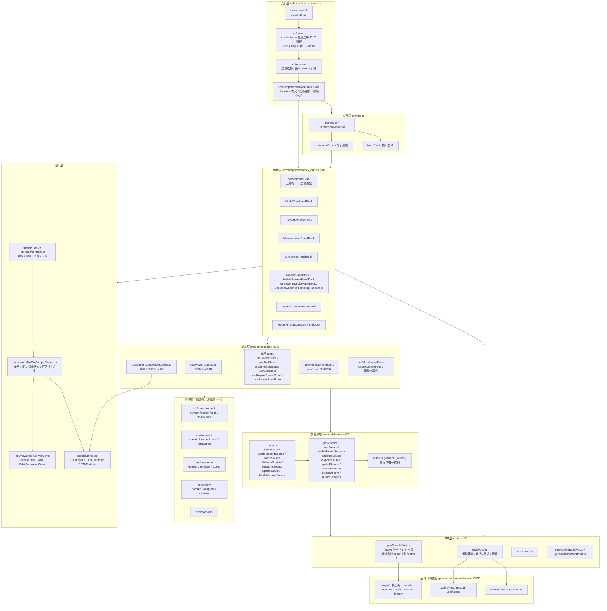
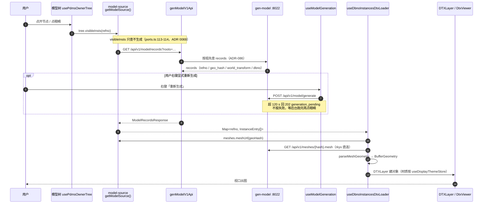
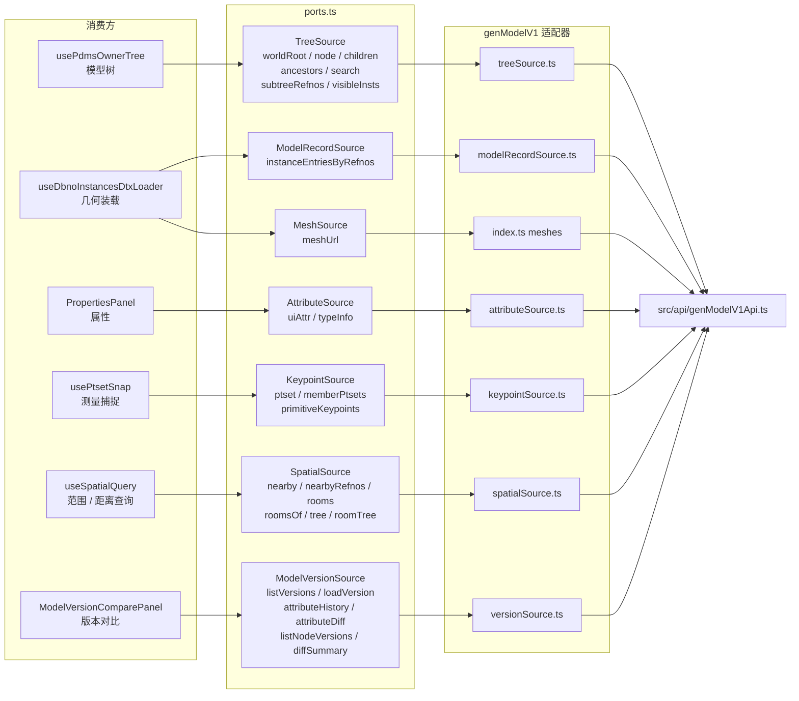
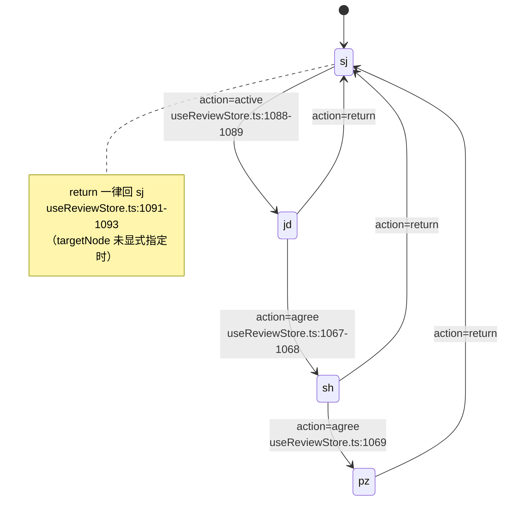
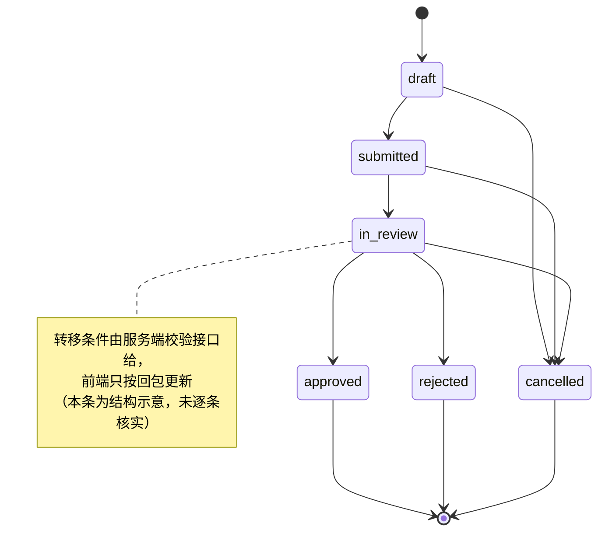

# Plant3D-Web 架构与流程图

> 依据仓库现状（`main`，2026-10-31）从源码读出的分层与数据流。
> 生成方式：本机 `cursor-agent` 未登录（非交互调用被拒），改由主会话逐文件核对后成图。
> 图中路径均可点击核对。

## 1. 分层架构

## 2. 三维模型加载主链路

`gen-model-v1` 是唯一数据源（legacy `:3100` + parquet/DuckDB-WASM 已于 2026-09-20 退役，见 `src/model-source/ports.ts:35-38`）。

## 3. 端口契约（数据源唯一收口）

`src/model-source/ports.ts` 只放类型，运行时代码在 `genModelV1/`。

## 4. 编校审工作流

两套并存的枚举，不要混用：**岗位节点**（`WorkflowNode`）与**任务状态**（`ReviewTask.status`）。

- 岗位节点：`sj | jd | sh | pz` = 编制 / 校对 / 审核 / 批准（`src/types/auth.ts:153`、`:166-171`）
- 动作：`submit | return | approve | reject`（`src/types/auth.ts:158`）
- 任务状态：`draft | submitted | in_review | approved | rejected | cancelled`（`src/types/auth.ts:180`）

### 4.1 岗位节点流转（外部校验驱动）

### 4.2 任务状态

### 4.3 面板对应

| 角色 | 面板 |
| --- | --- |
| 校核人待办 | `ReviewerTaskListPanelDock` + `useUserStore.pendingReviewTasks` |
| 审核人待办 | `ReviewerTaskListPanelDock`（同面板按角色过滤） |
| 设计人返工 | `DesignerTaskListPanelDock` + `DesignerCommentHandlingPanelDock` |
| 批注表格 | `AnnotationTableView` / `AnnotationSheetWorkspace` |
| 发起 | `InitiateReviewPanelDock` |

## 5. 目录职责速查

| 目录 | 文件数 | 职责 |
| --- | --- | --- |
| `src/components` | 243 | 面板、审查 UI、模型树、工具栏、弹窗 |
| `src/components/dock_panels` | 28 | dockview 面板壳，`main.ts` 全局注册 |
| `src/components/review` | 118 | 审查面板、批注表格、嵌入模式、快照 |
| `src/composables` | 216 | 状态与流程编排（`useXxx` 单例） |
| `src/dimension` | 181 | 尺寸标注：domain / kernel / ports / interaction / ui |
| `src/measurement` | 59 | 测量：domain / kernel / pick / snap / aids / tubing |
| `src/review` | 47 | 审查领域模型、适配器、服务 |
| `src/clearance` | 29 | 净距 / 穿墙检查 |
| `src/viewer` | 29 | Three.js 视口、相机意图、e3d 外观、版本浏览桥 |
| `src/model-source` | 26 | 数据源端口 + gen-model-v1 适配器 |
| `src/utils` | 132 | 通用工具，含 `utils/three/dtx` 几何层 |
| `src/api` | 12 | REST 客户端（`genModelV1Api` / `reviewApi` / `mbdV2Api`） |
| `src/ribbon` | 9 | 功能区菜单、命令总线、提示总线 |

## 6. 关键约束（逐条带行号依据）

1. **单一数据源**：`MODEL_SOURCE_KINDS` 只有 `'gen-model-v1'`，`getModelSource()` 惰性单例并 `activate()` —— `src/model-source/ports.ts:54`、`src/model-source/index.ts:22-27`。
2. **七端口固定**：`ModelSource` = `tree / records / meshes / attributes / keypoints / spatial / versions` —— `src/model-source/ports.ts:653-662`；装配在 `src/model-source/genModelV1/index.ts:114-126`。
3. **HTTP 单一出口**：适配器不得自拼 URL，一律经 `src/api/genModelV1Api.ts` —— `genModelV1Api.ts:1-17`。
4. **显示与生成分离**：`visibleInsts` 只查 `model/records` 不生成 —— `ports.ts:113-114`；`model/generate` 仅显式触发 —— `genModelV1Api.ts:1000-1013`。
5. **自动补生成默认关闭**：仅 `?dtx_enable_auto_generation=1|true` 开启 —— `src/composables/useModelGeneration.ts:25-39`。
6. **网格直连**：`GET /api/v1/meshes/{geoHash}.mesh`（rkyv 原样），由装载链自行 fetch 后 `parseMeshGeometry` —— `genModelV1Api.ts:2848-2863`、`useDbnoInstancesDtxLoader.ts:574-590`。
7. **refno 归一**：服务端收发 `a/b` 与 `a_b`，本仓内部统一 `a_b`，转换只在 `genModelV1Api.ts` 做 —— `genModelV1Api.ts:20-27`。
8. **dev 代理**：前端 `:3101`，`/api` 与 `/gm` 默认打到 `http://localhost:8022`；旧 `:3100` 已退役 —— `vite.config.ts:42`、`:106-130`。

## 7. 分析方法与局限

本图由两条独立路径产出后交叉核对：

1. **主会话逐文件读取**：`main.ts`、`App.vue`、`DockLayout.vue`、`ports.ts`、`genModelV1/index.ts`、`genModelV1Api.ts`、`useDbnoInstancesDtxLoader.ts`、`useModelGeneration.ts`、`DtxViewer.ts`、`vite.config.ts`、`types/auth.ts`、`useReviewStore.ts`。
2. **cursor-agent 只读分析**（`--mode ask --trust`，账号 `daiwuyun145000@outlook.com`）：两轮独立输出，结论与主会话一致的部分才采纳。

已发现并修正的两处偏差：

- 早期版本写成「点眼睛会触发生成」，实际 `visibleInsts` 只查不生成（`ports.ts:113-114`），已改。
- cursor-agent 第二轮的 `return` 边写成 `sh→jd`、`pz→sh`，与源码 `useReviewStore.ts:1091-1093`（return 一律回 `sj`）冲突，按源码定稿。

未核实项（不臆断，明确标注）：

- `ReviewTask.status` 各转移的具体触发条件（服务端校验接口回包驱动），本文只列枚举，不画条件边。
- `DTXLayer` 内部几何装配的逐函数调用顺序，本文只到「装载器 → 视口」这一层。

