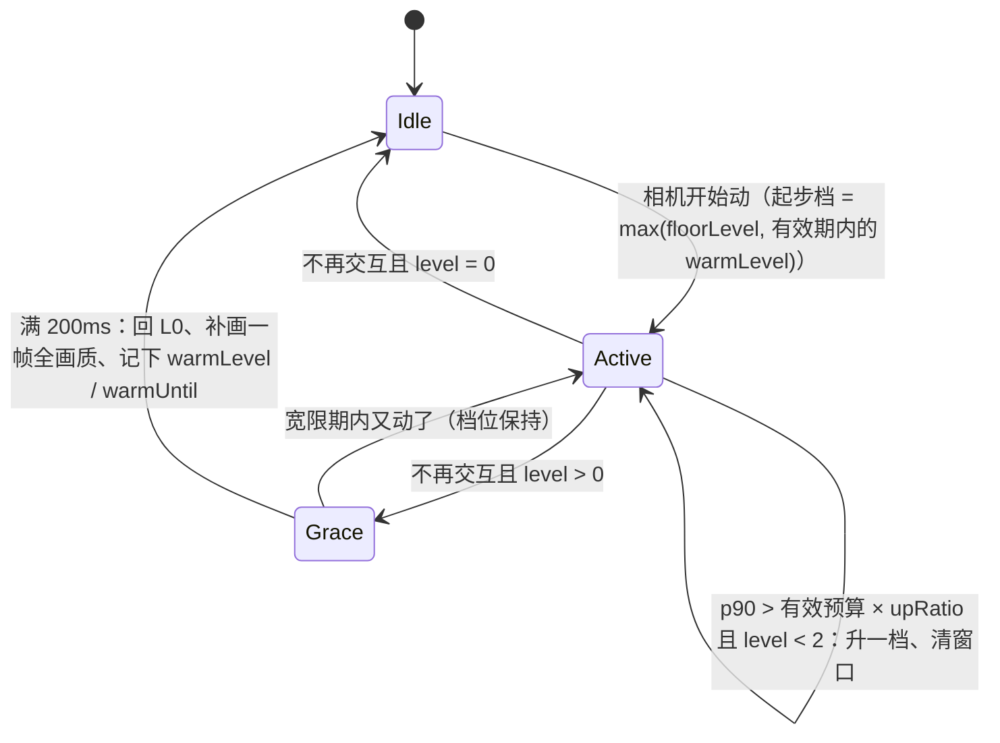

# 交互降画质按实测分档：评审后修订开发计划

依据 `C:\Users\dpc\.factory\specs\2026-11-07-spec.md`（下称 spec）和工作区里已有的未提交实现。大方向不变：**正常拖动保持全画质，只有真的掉帧才逐级关效果**。本计划修 spec 的设计缺陷并补齐验证。2026-11-08 用户已同意，按下表执行。

## 已确认的决定

| 编号 | 问题 | 决定 | 没选的做法 |
|---|---|---|---|
| D1 | 交互中耗时回落后要不要回升 | 同一次交互内只升档不降档，松手宽限 200ms 后回 L0 | 保留回升、每失败一次等待翻倍：长时间拖动仍会闪几次 |
| D2 | 连续操作的起步档 | 上次交互结束后 3 秒内再动，沿用上次的档位；超过 3 秒从 L0 重新试 | 每次从 L0 起步：重场景每次开头卡 5~6 帧 |
| D3 | 非 E3D 样式的小构件裁剪 | 恢复「相机一动就裁」（这些样式没有别的提速手段，<8px 构件拖动中看不出） | 与 spec 一致，测到超标才裁 |
| D4 | 页面被限到 30Hz（笔记本省电模式、部分远程桌面） | 空闲时探测刷新周期，预算放宽到一个刷新周期 | 不做，手动设 `dtx_frame_budget_ms=33.4` |
| D5 | 提交 | 改完先不提交，确认后只暂存本功能（`ViewerPanel.vue` 按块挑选） | — |

## 现状（已读代码确认）

- 已实现、未提交：`src/viewer/e3dLook/frameBudget.ts`（新）、`frameBudget.test.ts`（新）、`dragDowngrade.ts`、`dragDowngrade.test.ts`、`sglLookPipeline.ts`、`sglFramePasses.test.ts`、`index.ts`、`src/components/dock_panels/ViewerPanel.vue`。3 个测试文件 55/55 通过。上一个相关提交是 `393efa9d`（11-05，拖动一律降画质）。
- 状态机 `stepDragDowngrade`：`active = cameraMoving || (held && level > 0)`；交互中记样本，满 5 个取 p90；p90 > 预算 × 1.3 升一档并清窗口；p90 < 预算 × min(1.1, 1.3 × 0.9) 持续 500ms 降一档并清窗口；不交互时宽限 200ms 回 L0，报一次 `restored`。
- 测量：`renderFrame`（`ViewerPanel.vue:3496`）在 `:3500` 记 `frameStart`，画完在 `:3591` 写 `pendingFrameMs = performance.now() - frameStart`；下一帧 `updateDragDowngrade`（`:3411`）取走它。早退帧不写样本。
- 出帧：`scheduleFrame`（`:3386`）只挂一个 rAF；`requestRender`（`:3394`）置 `needsRender` 再排帧；`renderFrame` 末尾在相机还在变或持续渲染时排下一帧。`renderFrameImmediate`（`:3332`）在 resize 时同步画一帧，不经过 `renderFrame`。
- 管线：`sglFramePasses(params, level)` 按档位表开关各趟；`setDowngradeLevel` 每帧下发；`setInteracting(on)` 保留为 on → L2 的薄封装，全仓没有外部调用者。
- 裁剪：`updateCullDrag(level)`（`:3475`）在 `level >= 1 && cullDragEnabled()` 时 `setDragging(true)`；`DEFAULT_VIEW_CULL_OPTIONS.dragMinPx = 8`（`DTXViewCullController.ts:15`），默认开。`393efa9d` 里是相机一动就裁，有独立的一份状态。
- 重置：场景切换和卸载时 `:5453-5456` 清定时器、状态和 `pendingFrameMs`。
- 11-05 实测（RX590 / ANGLE D3D11）：5000 图元时 GPU 占用已 97%，单帧（含 GPU，`readPixels` 同步）22ms，只画颜色后 19~20ms。这台机器上重场景的瓶颈在 GPU 和几何，正是 CPU 计时看不到的部分。

## 评审发现的问题

1. **档位来回跳（高）**。回升判断看的是降档之后的耗时，而能否回到上一档取决于上一档的耗时。降档有效时耗时必然降到 18.4ms 以下，500ms 后回升、再超标、再降，周期约 0.7 秒。用真实的 `stepDragDowngrade` 模拟连续拖 5 秒（帧间隔取 max(耗时, 16.7ms)）：

   | 各档耗时 L0 / L1 / L2 | 5 秒内切换次数 | 表现 |
   |---|---|---|
   | 25 / 15 / 10 ms | 14 | L0↔L1，HLR 边线约每 0.7 秒闪一次，每次回 L0 卡 5 帧 |
   | 30 / 20 / 12 ms | 1 | 20ms 恰好落在 18.4~21.7ms 迟滞带内，稳定在 L1 |
   | 40 / 30 / 17 ms | 14 | L1↔L2 来回跳 |

   现有状态机用例都是固定耗时序列，没有「耗时随档位变化」的用例，所以没测出来。违反 spec 验收第 4 条。
2. **只测 CPU 时间（高）**。`performance.now()` 包住的是 JS 工作和 WebGL 命令提交；WebGL 异步执行，AO / HLR 全屏趟的 GPU 开销基本不在里面。GPU 吃紧时实际在掉帧，测出来却可能低于 21.7ms，一直停在 L0，比旧方案更卡。spec 验收第 2 条看的是「帧间隔分布」，与实现口径不一致。
3. **每次拖动开头先卡（中）**。每次交互从 L0 起步，攒够 5 个样本再加 1 帧滞后才降档：模拟 L0 = 40ms 时 200ms 才到 L1、350ms 才到 L2；旧方案第一帧就流畅。
4. **小构件裁剪语义变了（中）**。旧实现一动就裁（所有样式）；现在要测到超标升到 L1 才裁。非 E3D 样式里裁剪是唯一手段（L1、L2 没区别），重模型拖动开头不再立刻裁，还会受第 1 条影响，小构件一闪一闪。
5. **提交混杂（中）**。`ViewerPanel.vue` 的改动里混着无关的评审 / 碰撞存储作用域改动（`reviewPersistenceScope`、`clearanceStorageContext`），工作区还有大量其他未提交改动；spec 的「单个提交可 git revert」要按块挑选暂存才成立。
6. **文档（低）**。spec 的现状和行号已过时；状态图漏了 L1/L2 经宽限回 L0；`sglFramePasses.test.ts` 不在改动清单；验收用的 `npm run lint` 带 `--fix`，会改到无关文件。

## 修订后的设计

### 状态机（`dragDowngrade.ts`）

- **一次交互**：从第一帧 active 开始，到回 L0 为止（L0 时停手立即结束；降级中经 200ms 宽限）。状态新增 `inGesture`。`held && level > 0` 保持交互的规则不变。
- **只升不降（D1）**：p90 > 有效预算 × `upRatio` 就升一档、清窗口，每帧最多一档；耗时回落不回升。删除回升分支和 `lowSince`、`downRatio`、`holdMs`、`DEFAULT_RECOVER_RATIO`、`DEFAULT_RECOVER_HOLD_MS`。
- **起步档（D2）**：交互结束时记下 `warmLevel`（因为只升不降，就是本次交互到过的最高档）和 `warmUntil = now + warmMs`；新交互第一帧若 `now <= warmUntil`，直接从 `warmLevel` 开始。`warmMs` 默认 3000，`dtx_downgrade_warm_ms=0` 关闭。起步档不是 L0 时，第一帧拿到的样本来自静止帧（按 L0 画的），不计入窗口。
- **最低档（D3）**：输入新增 `floorLevel`，交互中档位不低于它。宿主在非 E3D 样式传 1、E3D 样式传 0。
- **有效预算（D4）**：输入新增 `refreshMs`，有效预算 = max(`budgetMs`, `refreshMs`)。60Hz / 120Hz 屏不变，被限到 30Hz 时预算变成 33.3ms。
- **调试**：状态新增 `flips`，即本次交互里由实测引起的档位变化次数，到下一次交互开始才清零，松手后也能看。

### 测量口径（`frameBudget.ts` + `renderFrame`）

- 样本改为「上一帧的 CPU 耗时」和「上一帧开始到本帧开始的出帧间隔」取大值。GPU 跟不上时浏览器会推迟下一次 rAF，间隔就会变长，所以 GPU 开销能反映出来。
- 只有上一帧画完时已经排上了下一帧（`renderFrame` 结束时 `rafId !== null`），间隔才代表上一帧的真实耗时；否则（中间空闲、早退、`renderFrameImmediate`、场景重置）只用 CPU 耗时。
- 新增纯函数 `frameSampleMs(prev: FrameTiming | null, start, useInterval)`，`FrameTiming = { start, cpuMs, scheduledNext }`。宿主把 `pendingFrameMs` 换成 `lastFrameTiming`。
- 60Hz 下出帧间隔只会是 16.7 / 33.3ms，所以 p90 超过 21.7ms 就等于超过 10% 的帧错过垂直同步，对应「真的掉帧」。
- `dtx_frame_metric=cpu` 退回只用 CPU 耗时，便于对比和临时回退。
- 不用 GPU 计时查询（`EXT_disjoint_timer_query_webgl2`）：浏览器支持不稳定。

### 刷新周期探测（D4）

- 新增 `probeRefreshMs(requestFrame, { count, busy })`：连挂 20 个空 rAF，取相邻回调间隔的中位数（`medianRefreshMs`），夹在 [4, 50]ms；探测期间出了帧就作废，返回 null。
- 时机：视口初始化后约 1.5 秒，以及每次交互结束后；30 秒内最多量一次。量不到时 `refreshMs` 为 null，预算按 `budgetMs` 算，和现在一样。

### 开关

| 开关（URL 优先，其次 localStorage） | 默认 | 作用 |
|---|---|---|
| `dtx_drag_downgrade=0` | 开 | 整体关闭（已有） |
| `dtx_frame_budget_ms` | 16.7 | 帧预算（已有） |
| `dtx_downgrade_ratio` | 1.3 | 升档倍数（已有） |
| `dtx_frame_metric=cpu` | interval | 只用 CPU 耗时（新增） |
| `dtx_downgrade_warm_ms` | 3000 | 起步档沿用时长，0 关闭（新增） |

开发模式下 `window.__dtxDowngrade` 增加 `cpuMs`、`intervalMs`、`sampleMs`、`refreshMs`、`flips`、`warmLevel`、`metric`，验收直接读这些字段。

## 开发步骤

### 第 1 步：状态机

- `dragDowngrade.ts`：按上面的设计改 `DragDowngradeState`、`DragDowngradeInput`、`DragDowngradeOptions`、`stepDragDowngrade`、`readDragDowngradeOptions`，新增 `effectiveBudgetMs`、`readFrameMetric`、`DEFAULT_WARM_START_MS`，文件头注释同步。
- `index.ts`：导出随之调整。
- `dragDowngrade.test.ts`：删掉「需持续 500ms 才降回 L1」「迟滞带内既不升也不降」「降档阈值低于升档阈值」，新增：
  - 交互中耗时回落也不回升；
  - 耗时随档位变化的模拟（上表三组，连续拖 5 秒）：只升不降，`flips <= 2`；
  - 起步档：3 秒内再动第一帧就是上次的档位，超过 3 秒从 L0 开始，`warmMs = 0` 不沿用，起步档非 L0 时第一帧样本不计入；
  - 最低档：`floorLevel = 1` 第一帧就是 L1，松手宽限后回 L0 并报 `restored`，超标仍能升到 L2；
  - 有效预算：`refreshMs = 33.3` 时 34ms 的帧不升档，`refreshMs` 小于预算或非法时按预算算；
  - `readFrameMetric` 和 `dtx_downgrade_warm_ms` 的读取。

### 第 2 步：测量口径

- `frameBudget.ts`：新增 `FrameTiming`、`frameSampleMs`。
- `ViewerPanel.vue`：`pendingFrameMs` 换成 `lastFrameTiming`；`renderFrame` 画完时写 `{ start, cpuMs, scheduledNext: rafId !== null }`；`updateDragDowngrade` 多收一个 `frameStart`，用 `frameSampleMs` 求样本；`renderFrameImmediate` 和 `:5453` 的重置处把 `lastFrameTiming` 置 null；传 `floorLevel`；读 `dtx_frame_metric`；`__dtxDowngrade` 加字段。
- `frameBudget.test.ts`：补 `frameSampleMs`（链条完整、没排下一帧、没有上一帧、非法值、只用 CPU）。

### 第 3 步：刷新周期探测

- `frameBudget.ts`：新增 `medianRefreshMs`、`probeRefreshMs`（`requestFrame` 可注入）。
- `ViewerPanel.vue`：`scheduleRefreshProbe`，在初始化和交互结束后触发，结果作为 `refreshMs` 传给状态机；卸载时清定时器。
- `frameBudget.test.ts`：60Hz / 120Hz / 30Hz、异常值夹紧、探测中途出帧作废。

### 第 4 步：检查与实测验收

- `npx vitest run src/viewer/e3dLook src/utils/three/dtx`；`npm run type-check` 不出现基线之外的新错误；`npx eslint <改动的文件>`（不加 `--fix`）；`npm run build-only`。
- 实测沿用 11-05 计划的方法：`npm run dev`，Playwright 驱动本机 Chrome，固定窗口尺寸，`page.mouse` 注入拖动，读 `window.__dtxDowngrade`；需要稳定负载时用 localStorage `dtx_continuous_render=1`。数据写到本文件的「执行记录」。

### 第 5 步：文档回写与提交（等用户确认）

- spec 顶部注明「已被本计划修订」，并更新现状、状态图和验收步骤（`npm run lint` 换成 `npx eslint <改动的文件>`）。
- 只暂存本功能文件，`ViewerPanel.vue` 用 `git add -p` 排除 `reviewPersistenceScope` / `clearanceStorageContext` 相关块；提交前用 `git diff --cached --stat` 核对。

## 验收标准（取代 spec 的「验证」一节）

1. 第 4 步的检查全部通过。
2. 轻场景（`?show_dbnum=7997`，或 `?dtx_demo=primitives&dtx_demo_count=500`）：连续拖动 5 秒，`level` 全程为 0，`flips = 0`。
3. 重场景（`?dtx_demo=primitives&dtx_demo_count=100000`）：首次拖动到 L1 不超过 6 帧、到 L2 不超过 12 帧；松手前只有升档，`flips <= 2`；松手约 200ms 后回 L0 并补一帧全画质；3 秒内再拖，第一帧就是上次的档位。
4. GPU 瓶颈（窗口放大到全屏、像素比 2）：出现 `cpuMs` 低于 21.7ms、而 `intervalMs` 的 p90 高于 21.7ms 时能升档；同一场景加 `dtx_frame_metric=cpu` 时不升档，证明口径改动有效。
5. 静止帧与改动前（`393efa9d`）逐像素一致（静止帧恒为 L0）。
6. 非 E3D 样式：一动就裁小构件，松手 200ms 后恢复并补一帧。
7. 开关：`dtx_drag_downgrade=0` 全程 L0；`dtx_frame_metric=cpu` 只用 CPU 耗时；`dtx_downgrade_warm_ms=0` 不沿用起步档。

## 风险

- 长时间拖动中从重区域转到轻区域，画质要到松手才恢复（D1 的取舍）。
- 3 秒内连续操作会沿用上次档位；场景变轻后要停手超过 3 秒才重新从 L0 试（D2 的取舍）。
- 页面在后台时 rAF 暂停，没有样本，档位保持不变，不影响正确性。
- 降档只减少 GPU 趟和绘制，不减少标注 / 标签的 DOM 更新；瓶颈在标签时会白降到 L2，但不影响正确性。

## 回退

- 运行时：`dtx_drag_downgrade=0` 整体关闭；`dtx_frame_metric=cpu` 只退回测量口径；`dtx_downgrade_warm_ms=0` 只关起步档。
- 代码：本功能单独提交，可整体 `git revert`。

## 不在本次范围

GPU 计时查询、动态降分辨率（可作为以后的 L3）、标注 / 标签的 DOM 开销。

## 执行记录

### 2026-11-08 实施（第 1–4 步）

改动文件：

- `src/viewer/e3dLook/dragDowngrade.ts`：状态机按 D1–D3 重写（只升不降、起步档、最低档），新增 `effectiveBudgetMs`、`readFrameMetric`、`DEFAULT_WARM_START_MS`；删掉回升分支和 `downRatio`、`holdMs`、`DEFAULT_RECOVER_*`。
- `src/viewer/e3dLook/frameBudget.ts`：新增 `FrameTiming`、`frameSampleMs`、`medianRefreshMs`、`probeRefreshMs`。
- `src/viewer/e3dLook/index.ts`：导出同步。
- `src/viewer/e3dLook/dragDowngrade.test.ts`（34 条）、`src/viewer/e3dLook/frameBudget.test.ts`（18 条）。
- `src/components/dock_panels/ViewerPanel.vue`：`pendingFrameMs` 换成 `lastFrameTiming`；`updateDragDowngrade` 多收 `frameStart`，传 `floorLevel`、`refreshMs`，`__dtxDowngrade` 加字段；交互期间一直挂唤醒定时器（到点只排一帧让状态机重新判断，见下文「补修」）；新增 `scheduleRefreshProbe`（初始化后 1.5 秒、每次交互结束后 0.5 秒）；`renderFrameImmediate` 和卸载处清出帧记录，卸载时清探测定时器。
- `docs/verification/frame-budget-2026-11-08/accept.mjs`、`result.json`：实测脚本和原始数据；`pixel-compare.mjs`、`pixel-compare.json`：验收第 5 项的逐像素对比脚本和结果。

与设计的差异：刷新周期探测被出帧打断时不进入 30 秒冷却，下一次交互结束再试；量到结果才开始冷却。

检查：

- `npx vitest run src/viewer/e3dLook src/utils/three/dtx`：18 个文件、197 条全部通过。
- `npm run type-check`：当前 0 条错误，基线 0 条，新增 0。
- `npx eslint <6 个改动文件>`（不加 `--fix`）：无输出，退出码 0。
- `npm run build-only`：通过（18.3 秒），只有原有的 chunk 大于 500kB 提示。

实测：`node docs/verification/frame-budget-2026-11-08/accept.mjs`。本机 3101 端口的开发服务，Playwright 驱动无头 Chrome（`--use-angle=d3d11`，60Hz），内置图元演示场景，拦截 `window.__dtxDowngrade` 的赋值逐帧记录。17 项检查全部通过（表中数字取自补修后的最后一轮）：

| 验收项 | 场景 | 结果 |
|---|---|---|
| 2 | E3D，500 个图元，拖 5 秒 | 351 帧全程 L0，flips 0；CPU p90 0.9ms，出帧间隔 p90 16.9ms |
| 3 | E3D，100000 个图元，拖 5 秒 | 第 4 帧到 L1、第 9 帧到 L2，之后 264 帧都是 L2，flips 2；相机停稳后 200.2ms 回 L0，管线档位 0 |
| 3 | 同上，3 秒内再拖 2 秒 | 第一帧就是 L2，86 帧全程 L2，出帧间隔 p90 16.9ms |
| 3 | 同上，停 3.5 秒后再拖 | 从 L0 起步，第 4 / 9 帧升到 L1 / L2 |
| 3 | 同上，拖完 3 秒内一步到位转相机 30° | 按起步档 L2 出画，335ms 后自己回 L0 |
| 3 | 同上，拖到 L2 后按住不动 2 秒再松手 | 按住期间保持 L2（`moved=false`、`held=true`），松手后 191ms 回 L0 |
| 4 | E3D，20000 个图元，1920×1080、像素比 2 | `dtx_frame_metric=cpu`：138 帧全程 L0，CPU p90 1.9ms，出帧间隔 p90 78.1ms（约 13 帧/秒，只看 CPU 测不到 GPU 瓶颈）；默认口径：第 5 / 10 帧升到 L1 / L2，之后出帧间隔 p50 16.7ms |
| 5 | 静止帧与改动前逐像素对比（见下文） | E3D、非 E3D 的初始帧和停稳帧都是 0 像素不同 |
| 6 | 非 E3D（`dtx_look=pbr`），500 个图元，拖 3 秒 | 第一帧就是 L1，拖动中小构件裁剪开启；停稳后 200.1ms 回 L0、裁剪关闭 |
| 6 | 非 E3D，一步到位转相机 30°（模拟视图立方体 / 定位构件） | 先到 L1，218ms 后自己回 L0、裁剪关闭 |
| 7 | `dtx_drag_downgrade=0`，100000 个图元 | 全程 L0、`enabled=false`；出帧间隔 p50 332.8ms（约 3 帧/秒），对照开启降档时 L2 的 16.7ms |
| 7 | `dtx_downgrade_warm_ms=0`，100000 个图元 | 第二次拖动从 L0 起步 |
| 7 | `dtx_frame_metric=cpu` | 见第 4 项：样本只取 CPU 耗时 |

说明：

- 刷新周期：最后一轮各场景初始化后都量到 16.7ms；第一轮 100000 个图元的场景探测被出帧打断（`refreshMs = null`），预算按 `budgetMs` 算，行为与 60Hz 相同。关掉降档的那一轮一直在出帧，探测始终量不到。
- 冷启动的前 9 帧仍按 L0 / L1 出画（这个极端场景 L0 每帧约 333ms），第一次拖动开头会卡一下。3 秒内的后续拖动靠起步档免掉这一段：关掉起步档时第二次拖动出帧间隔 p90 330.5ms，开着时 16.9ms。
- `dtx_drag_downgrade=0` 一轮松手后 20 秒内没停稳：全画质下每帧约 333ms，阻尼尾巴要很多帧，不影响结论。
- 第 5 步（spec 回写、提交）等用户确认。

### 2026-11-08 验收第 5 项与补修

改动前以 HEAD（`d2d4bf17`）为准：第 5 项写的是 `393efa9d`，但它之后这几个文件还有 3 个已提交的改动（`0e95229e` 拖动时 E3D 外观只画颜色趟、`c3b1cd74`、`d894ee0c` 按构件选段绘制与显示用粗网格），直接对比 `393efa9d` 会把这些已提交的改动也算进来。

方法：把工作区复制一份，只把本功能的 8 个文件换回 HEAD（`frameBudget.ts` 及其测试删掉；`ViewerPanel.vue` 整个换回，其中与本功能无关的未提交改动是审核 / 净距的存储作用域，不影响渲染），其余未提交改动不变，另起开发服务（3111 端口）当改动前的版本；`node docs/verification/frame-budget-2026-11-08/pixel-compare.mjs http://localhost:3101 http://localhost:3111 <out.json>`。2000 个图元的演示场景，E3D（`dtx_look=sgl&dtx_look_preset=factory`）和非 E3D（`dtx_look=pbr`）各采三张画布截图：加载后静止、一步到位绕 Z 轴转 30° 后 2.5 秒、再发一次不动相机的 `change` 后 1.5 秒（停稳）。连续两张截图完全相同才算画面停稳；新版加载两次，给出同一版本两次加载之间的噪声底线。

结果（`pixel-compare.json`，画布 900×600）：

| 截图 | E3D 新 vs 旧 | 非 E3D 新 vs 旧 | 新版两次加载的噪声 |
|---|---|---|---|
| 初始（静止） | 0 像素不同 | 0 像素不同 | 0 |
| 转相机后 2.5 秒 | 53015 像素不同（最大差 221） | 45764 像素不同（最大差 221） | 0 |
| 停稳 | 0 像素不同 | 0 像素不同 | 0 |

转相机后那张的差异在旧版一侧：旧版转完停在一帧和它自己的停稳帧不同的画面上（像素数同上，两张截图间隔 700ms 不变），要再触发一次重绘才变成静止帧；新版转完就是静止帧（与停稳帧 0 像素不同，档位 0）。

补修：第一次跑这个对比时，新版非 E3D 转完停在 L1、小构件裁剪一直开着。原因是按需出帧时，一步到位的相机变化（视图立方体、标准视图、定位构件）只出一帧，这一帧算「在动」，之后没有帧进来，状态机看不到「已停」；恢复定时器原来只在「没动」的帧上挂，挂不上。非 E3D 有最低档 L1、E3D 有起步档，都会停在降档画面上。按住不动再松手同理（`onControlsEnd` 不请求出帧）。修法：`updateDragDowngrade` 在交互期间一直挂唤醒定时器（`lastActiveAt + graceMs`），到点调 `scheduleFrame()` 只排一帧让状态机重新判断：真恢复时这一帧 `restored` 为真，会出全画质；仍按住不动就不重画。实测脚本加了 `stepAndHold` 场景的 3 项检查（见上表）。修完后重跑：vitest 197 条通过、type-check 新增 0、eslint 退出码 0、build-only 通过（18.3 秒）。
