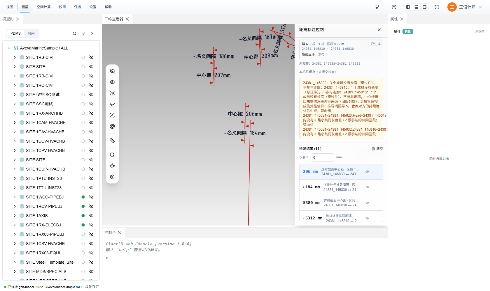
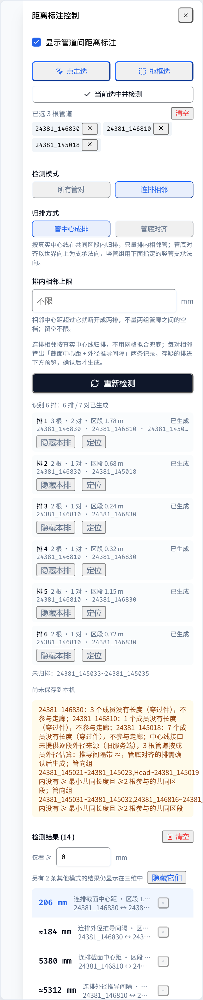
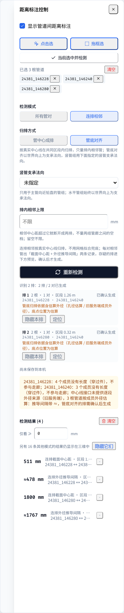

# 管道连排相邻测量：操作教程与验证（2026-10-22）

`docs/plans/2026-10-19-pipe-row-adjacent-measurement-plan.md` 的使用说明与真机验证记录；关联 issue #93（排管间距测量）。

## 环境

- 后端：`aios-database`（gen-model `refactor` 线）`:8022`，库 7997（AvevaMarineSample）。这一版中心线接口**不给逐段外径来源**（`diameter_evidence`）和 `source_version`，前端按「旧服务端成员外径」估算（见 §3.1）。
- 前端提交：`28d739ab`（直段与外径证据）、`4088676a`（记录契约与推导精度档）、`095084df`（连排几何）、`a26e7e1b`（抽屉连排模式）、`3514b70c`（空间查询 / 校审口径）、`930afc26`（三维文字 ≈ 字形）。
- 检查：相关单测全过；`npm run type-check` 473 条 = 基线、新增 0；改动文件 ESLint 干净。

## 一、操作教程

### 1. 打开与选管

1. 功能区「测量 → 管理 → 管道距离」，右侧弹出「距离标注控制」抽屉。
2. 选管道（只认 BRAN）：
   - 「点击选」：在三维里逐根点，Enter 确认、ESC 取消；
   - 「拖框选」：按住左键拖框（向左拖完全包含，向右拖相交即选）；
   - 或先在三维 / 模型树里选中，再点「当前选中并检测」。

   已选管道以标签列出，可单个移除或「清空」。

### 2. 设置

1. 检测模式选 **连排相邻**。「所有管对」是另一套外表面净距检测，两套结果分开显示。
2. 归排方式：
   - **管中心成排**：截面里管中心在一条线上的算一排（等径管排、竖向叠放）。
   - **管底对齐**：管底贴同一支承面的算一排（不同管径放在同一层管架上）。缺省以世界向上为支承法向；主管向近铅直的竖管组要在 **竖管支承法向** 里指定管底贴靠的方向（±X / ±Y），否则提示「支承法向退化」。
3. **排内相邻上限**（可空）：相邻中心距超过它就断开成两排，避免量两组管廊之间的空档；留空不限。
4. 点 **重新检测**。

### 3. 识别预览与确认

检测后，按钮下方列出识别到的每一排：根数、相邻对数、区段长度、状态和诊断。

- **已生成**：分组可证，直接出结果。
- **待确认（多解 / 分组不完整 / 估算外径）**：存在同等合理的其他分法、剩下两根只凭两点成排、两管共轴重合、同截面有管缺外径没法归排，或管底对齐是按估算外径定位的底点。核对后点 **确认生成**，或「全部确认」；这些记录会注明「本排经人工确认后生成」。
- **隐藏本排 / 显示本排**：只开关这一排的记录，列表与三维同步，不影响其他排和其他来源的净距。
- **定位**：飞到这一排的测量截面。
- 「未归排」列出进了共同区段、但不在任何排里的管。

### 4. 读结果

每对相邻管两条记录：

| 记录 | 含义 |
| --- | --- |
| 连排截面中心距 | 两管真实中心线在测量截面上的交点距离 D，截面取这对管共同区段的中点 |
| 连排外径推导间隔 | G = D − (外径₁ + 外径₂) / 2，平行圆柱模型的名义值，**不是**实体外表面精算 |

推导间隔的写法：

- `186 mm`：正间隔；`≈186 mm`：至少一侧外径是估算（通径估算或旧服务端成员外径）。
- `名义接触`：|G| ≤ 0.5 mm（显示口径，不是合格判据）。
- `名义重叠 12 mm`：G < 0，名义外径包络重叠，不等于实体相交。
- `缺外径`：任一侧外径来源不可证，只给中心距。

其他：

- 行内显示「过期，待重算」「重算失败，旧值」和区段长度；鼠标悬停看归排方式、截面点坐标、沿管向区段、两侧外径及来源。
- 点行：高亮两根管并飞到测量截面；眼睛按钮单条隐藏；「仅看 ≥」按距离筛选列表。
- 列表只显示当前模式（所有管对 / 管中心 / 管底）的结果；其他模式的结果仍画在三维里时会提示「另有 N 条…」，可「隐藏它们」。列表的「清空」只清当前模式。
- 三维：红色尺寸线，「中心距 …mm」和「名义间隔 …mm」画在连线两侧；外径为估算时文字前带 `~`（三维字库没有 `≈`）。
- 推导间隔「转为尺寸」时一律标近似。空间查询抽屉「已保存的构件净距」里的连排记录不能「重算」，要回到这里重新检测。

## 二、效果图

本机后端没有生成 7997 库的模型几何，三维里只有标注、没有管道实体；中心线是真实数据。

图 1：管中心成排，`24381_146830 / 146810 / 145018` 三根管；三维标注中心距与名义间隔，右侧抽屉为识别预览与结果。

图 2：识别 6 排 7 对，全部直接生成；结果列表数值带单位，估算外径带 ≈。

图 3：管底对齐（`24381_146228 / 146240 / 146280`），外径是旧服务端成员外径（估算），两排标「待确认（估算外径）」。

图 4：「全部确认」后生成 4 条记录；列表只显示管底对齐的结果，并提示其他模式的结果仍在三维中。

## 三、验证记录

### 3.1 旧服务端外径估算

gen-model `refactor` 的 `branch_query` 里，隐式管身 `X~m` 和它到达的成员 `m` 用同一槽位管子目录外径、同一到达通径算外径（`outside_diameter(slot_od, arrive_bore)`），但中心线响应把隐式管身外径置空，也不给来源。前端在「整条中心线没有任何逐段 `diameter_evidence`」时按同一规则复用；`m` 零长未成段时退到离开成员（异径管不退），记 `legacy-member`（估算）。

- `24381_145018`：10 条直段外径全部补到 114.3。改前全部是 `unverified`：推导间隔缺失，管底对齐 0 结果。

### 3.2 区域规模

区域 `24381_144870`（137 PIPE / 165 BRAN / 547 条直段）全量识别：管中心 39 ms，管底 5 ms，不卡主线程。

### 3.3 浏览器流程

headless Chrome + 抽屉 harness（`harness/pipe-distance.html`），接本机后端真实中心线。

| 步骤 | 结果 |
| --- | --- |
| 管中心成排，3 根管 | 6 排 7 对全部生成，14 条记录 |
| 排内相邻上限 2000 mm | 中心距 2.1–5.6 m 的跨距断开，剩 4 排 4 对 |
| 管底对齐，3 根管 | 2 排待确认（估算外径）→ 全部确认 → 4 条记录 |
| 隐藏本排 / 显示本排 | 只动该排 2 条记录 |
| 切换模式 | 列表按模式隔离；「隐藏它们」后提示消失 |
| 控制台 | 无页面错误（外网字体加载失败除外） |

### 3.4 回归用例

- 几何：错开起止不重复量同一对；剩两根不平行进确认、平行的第二层照常成排；共轴 ≤ 1 mm 标歧义；管底按估算外径归排待确认；竖管支承法向；相邻上限断开；同一 BRAN 首尾搭接当同一根管。
- 直段：旧服务端外径推断。记录：人工确认替换 stale 旧记录、数值文字。
- store：旧服务端端到端、预览确认、模式隔离、预览过期。ClearanceStore：连排记录拒绝整构件重算。字库：≈ 用 ~ 代画。

## 四、已知限制

- 后端 `a1e3210cd`（逐段外径证据）、`f993816c7`（`source_version`）还没进 `refactor` / `publish`：外径只能按估算处理（推导间隔带 ≈、管底对齐要确认），记录也没有模型版本号。
- 三维效果图里没有管道实体（本机后端未生成模型几何）。
- 从功能区打开抽屉时，控制台有一条 `ReferenceError: rangeDrawerOpen is not defined`（`ViewerPanel.vue` 既有问题，抽屉照常打开）。
