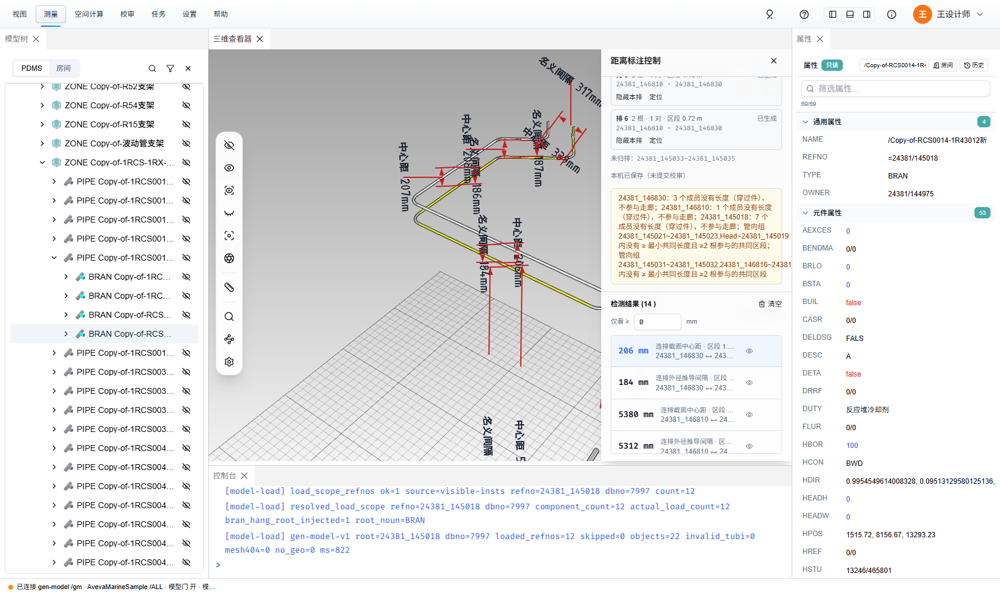
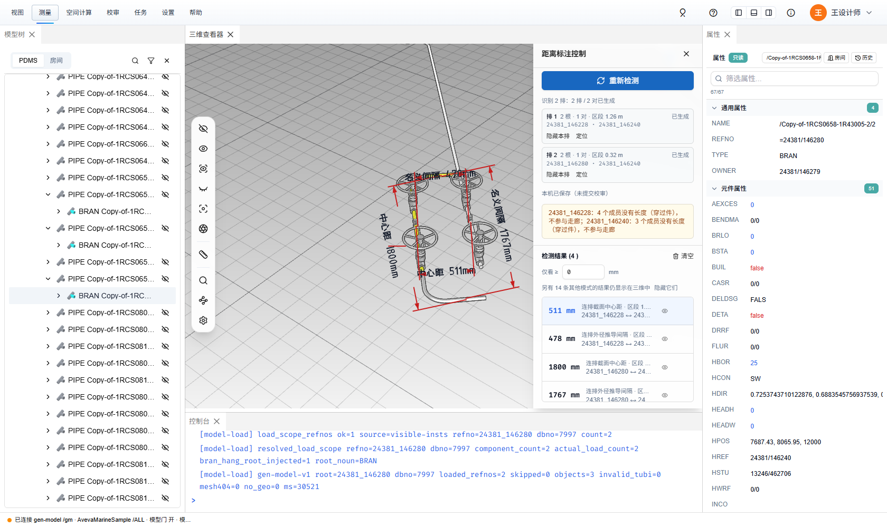
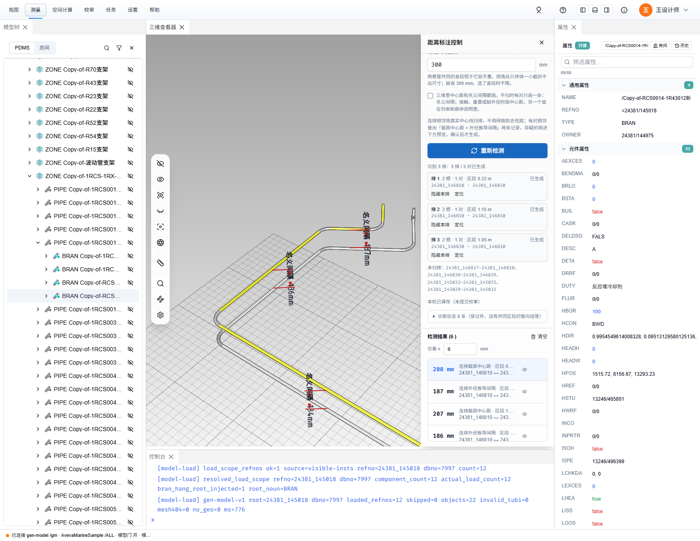
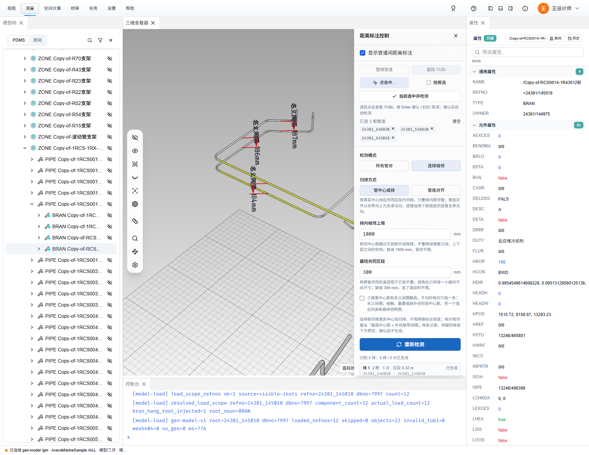
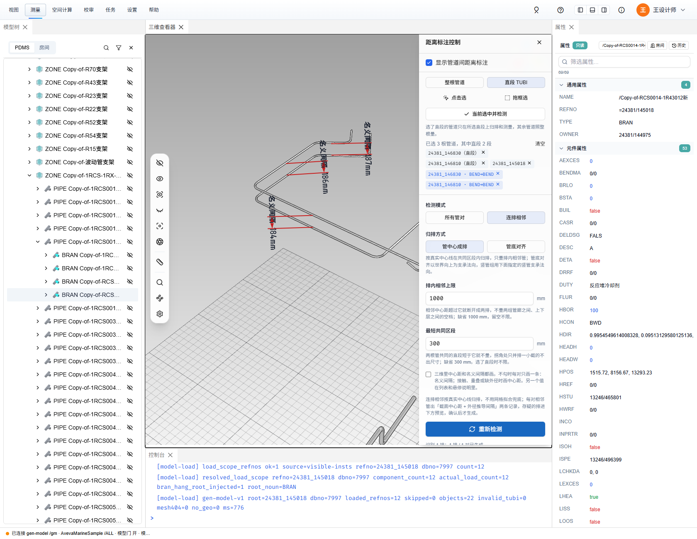
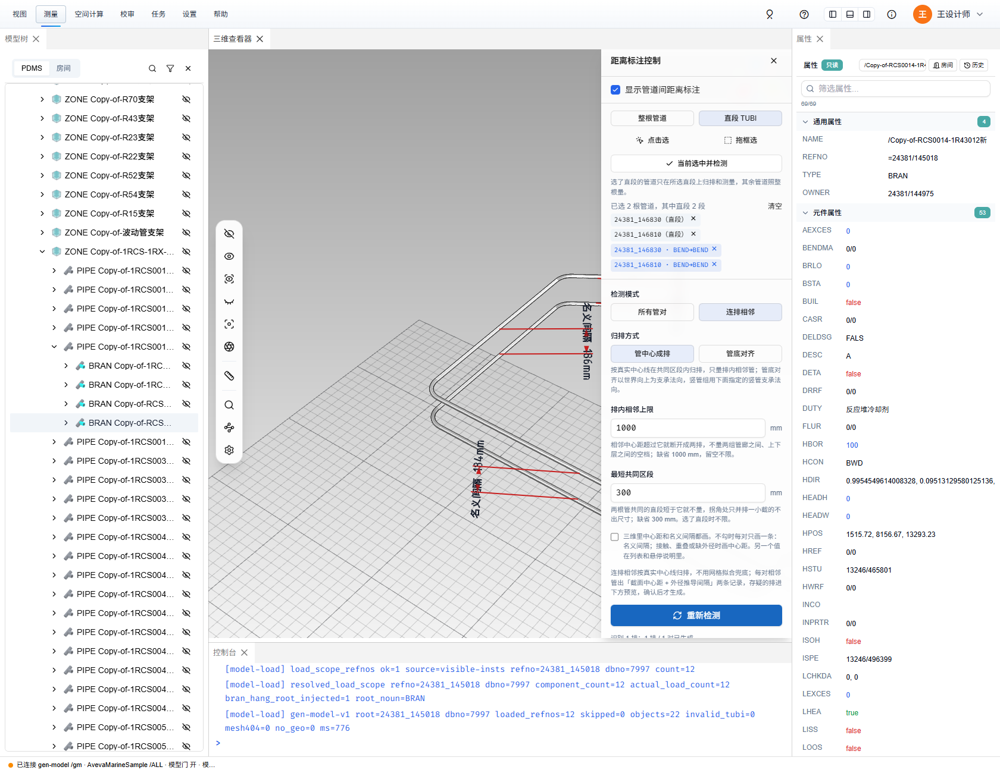
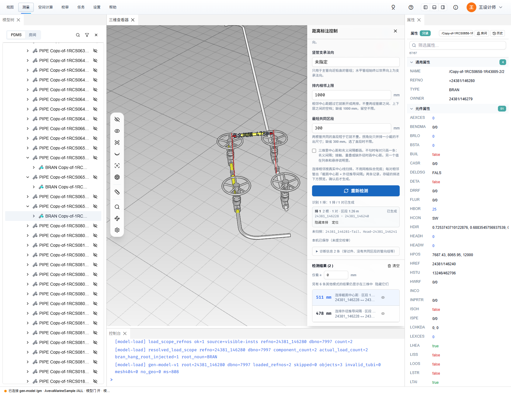

# 管道连排相邻测量：操作教程与验证（2026-10-22）

`docs/plans/2026-10-19-pipe-row-adjacent-measurement-plan.md` 的使用说明与真机验证记录；关联 issue #93（排管间距测量）。

## 环境

- 后端：
  - 首轮（图 1–4）：`aios-database`（gen-model `refactor` 线）`:8022`，库 7997（AvevaMarineSample）。这一版中心线接口**不给逐段外径来源**（`diameter_evidence`）和 `source_version`，前端按「旧服务端成员外径」估算（见 §3.1）。
  - 0.1.42 起（图 5–13）：线上 `123.57.182.243:3100`（gen-model 0.1.42，`220a6ec87`）。中心线逐段给外径来源和 `source_version`，模型记录里的直管带直段身份 `tube`。
- 前端提交：
  - 首轮：`d688c20b`（直段与外径证据）、`9dd120ef`（记录契约与推导精度档）、`860ebf7c`（连排几何）、`e17ff360`（抽屉连排模式）、`a33c57ae`（空间查询 / 校审口径）、`aa2c5997`（三维文字 ≈ 字形）、`c67f2bb8`（功能区打开抽屉的报错）。
  - 第二轮：`ca5979d9`（直接选直段 TUBI、多选后自动检测）、`f50516da`（缺省相邻上限 / 最短共同区段、三维每对一条、诊断折叠）。
- 检查：全量 363 个测试文件、3459 个测试，只有改动前就失败、与本功能无关的 `form-binding`「external workflow mode」一条不过；`npm run type-check` 471 条 = 基线、新增 0；改动文件 ESLint 干净。

## 一、操作教程

### 1. 打开与选管

1. 功能区「测量 → 管理 → 管道距离」，右侧弹出「距离标注控制」抽屉。
2. 检测模式选 **连排相邻**。「所有管对」是另一套外表面净距检测，两套结果分开显示。
3. 选择对象（只在连排相邻模式出现）：
   - **整根管道**：选 BRAN，这根管所有直段都参与归排。
   - **直段 TUBI**：只选几段直管，这根管只在所选直段上归排和测量；没选直段的管照整根量。同一根管上连着选的几段合成一段量。
4. 选管：
   - 「点击选」：在三维里逐根（逐段）点，Enter 确认、ESC 取消；光标处有重叠的管或直段时按 Tab 切换。
   - 「拖框选」：按住左键拖框（向左拖完全包含，向右拖相交即选），松开即确认。
   - 或先在三维 / 模型树里选中，再点「当前选中并检测」：选中的管件、直管按所属 BRAN 算，按整根量。

   连排模式下，点击选按 Enter、拖框选松开后，已选够 2 根管就**直接检测**，不用再点「重新检测」。

   已选管道以标签列出，选了直段的管标「（直段）」。所选直段另列标签，如「24381_146830 · BEND→BEND」：两端是直段两头的管件类型，容器头 / 尾那一端写「头」/「尾」。标签都可单个移除，也可「清空」。

### 2. 设置

1. 归排方式：
   - **管中心成排**：截面里管中心在一条线上的算一排（等径管排、竖向叠放）。
   - **管底对齐**：管底贴同一支承面的算一排（不同管径放在同一层管架上）。缺省以世界向上为支承法向；主管向近铅直的竖管组要在 **竖管支承法向** 里指定管底贴靠的方向（±X / ±Y），否则提示「支承法向退化」。
2. **排内相邻上限**：相邻中心距超过它就断开成两排，不量两组管廊之间、上下层之间的空档。缺省 1000 mm，留空不限。
3. **最短共同区段**：两根管共同的直段短于它就不量，拐角处只并排一小截的不出尺寸。缺省 300 mm；选了直段时不限。
4. **三维里中心距和名义间隔都画**：缺省不勾，每对只画一条（见 §4）。
5. 改了设置后点 **重新检测**。

### 3. 识别预览与确认

检测后，按钮下方列出识别到的每一排：根数、相邻对数、区段长度、状态和诊断。

- **已生成**：分组可证，直接出结果。
- **待确认（多解 / 分组不完整 / 估算外径）**：存在同等合理的其他分法、剩下两根只凭两点成排、两管共轴重合、同截面有管缺外径没法归排，或管底对齐是按估算外径定位的底点。核对后点 **确认生成**，或「全部确认」；这些记录会注明「本排经人工确认后生成」。
- **隐藏本排 / 显示本排**：只开关这一排的记录，列表与三维同步，不影响其他排和其他来源的净距。
- **定位**：飞到这一排的测量截面。
- 「未归排」列出进了共同区段、但不在任何排里的管。
- 黄色提示框只放需要处理的事：待确认、中心线缺口、所选直段在中心线里对不上、旧服务端外径估算、竖管支承法向。穿过件、没有共同区段的管向组之类收在「诊断信息 N 条」里，点开看。

### 4. 读结果

每对相邻管两条记录：

| 记录 | 含义 |
| --- | --- |
| 连排截面中心距 | 两管真实中心线在测量截面上的交点距离 D，截面取这对管共同区段的中点 |
| 连排外径推导间隔 | G = D − (外径₁ + 外径₂) / 2，平行圆柱模型的名义值，**不是**实体外表面精算 |

推导间隔的写法：

- `186 mm`：正间隔；`≈186 mm`：至少一侧外径是估算（通径估算或旧服务端成员外径）。
- `名义接触`：|G| ≤ 0.5 mm（显示口径，不是合格判据）。
- `名义重叠 12 mm`：G < 0，名义外径包络重叠，不等于实体相交。
- `缺外径`：任一侧外径来源不可证，只给中心距。

其他：

- 行内显示「过期，待重算」「重算失败，旧值」和区段长度；鼠标悬停看归排方式、截面点坐标、沿管向区段、两侧外径及来源，以及同一对的另一个值。
- 点行：高亮两根管并飞到测量截面；眼睛按钮单条隐藏；「仅看 ≥」按距离筛选列表。
- 列表只显示当前模式（所有管对 / 管中心 / 管底）的结果；其他模式的结果仍画在三维里时会提示「另有 N 条…」，可「隐藏它们」。列表的「清空」只清当前模式。
- 三维：红色尺寸线。缺省每对只画一条「名义间隔 …mm」，中心距写在这条尺寸的悬停说明里；名义接触、重叠、缺外径或名义间隔被隐藏时改画「中心距 …mm」。勾选「三维里中心距和名义间隔都画」后两条分画在连线两侧。外径为估算时文字前带 `~`（三维字库没有 `≈`）。
- 某根管只选了直段时重新检测：这几段所在的整条直段上之前的结果被替换，别的直段上已有的结果保留。
- 推导间隔「转为尺寸」时一律标近似。空间查询抽屉「已保存的构件净距」里的连排记录不能「重算」，要回到这里重新检测。

## 二、效果图

### 首轮：本机后端，外径按旧服务端估算

本机后端没有生成 7997 库的模型几何，三维里只有标注、没有管道实体；中心线是真实数据。

图 1：管中心成排，`24381_146830 / 146810 / 145018` 三根管；三维标注中心距与名义间隔，右侧抽屉为识别预览与结果。

图 2：识别 6 排 7 对，全部直接生成；结果列表数值带单位，估算外径带 ≈。

图 3：管底对齐（`24381_146228 / 146240 / 146280`），外径是旧服务端成员外径（估算），两排标「待确认（估算外径）」。

图 4：「全部确认」后生成 4 条记录；列表只显示管底对齐的结果，并提示其他模式的结果仍在三维中。

### 0.1.42 后端，调整缺省之前

图 5：同样三根管，管中心成排：外径全部取目录值，间隔不带 ≈。6 排 7 对里有 5380 / 5586 / 2143 mm 的假邻管（当时相邻上限缺省不限）。

图 6：管底对齐直接生成，不再待确认。

图 7：三维加载了管道实体。当时每对画中心距与名义间隔两条，拐角处文字叠在一起。

图 8：阀组：511 / 478 mm 一对，另有相距 1.8 m、只并排 0.32 m 的一对。

### 0.1.42 后端，当前版本

图 9：新缺省下的管中心成排：3 排 3 对，都是 146830 ↔ 146810（名义间隔 187 / 186 / 184 mm）；三维每对一条，诊断收在「诊断信息 6 条」。

图 10：选择对象切到「直段 TUBI」，点击选两段平行直管，两段都高亮。

图 11：Enter 后自动检测：1 排 1 对（206 / 184 mm，区段 1.78 m）；已选列表标「（直段）」，并列出直段标签。

图 12：清空后在另一截上拖框选两段直管，松开即检测：207 / 186 mm，区段 1.15 m。

图 13：管底对齐新缺省：只剩 511 / 478 mm 一对，1.8 m 那对按相邻上限断开；三维只画名义间隔。

## 三、验证记录

### 3.1 旧服务端外径估算

gen-model `refactor` 的 `branch_query` 里，隐式管身 `X~m` 和它到达的成员 `m` 用同一槽位管子目录外径、同一到达通径算外径（`outside_diameter(slot_od, arrive_bore)`），但中心线响应把隐式管身外径置空，也不给来源。前端在「整条中心线没有任何逐段 `diameter_evidence`」时按同一规则复用；`m` 零长未成段时退到离开成员（异径管不退），记 `legacy-member`（估算）。

- `24381_145018`：10 条直段外径全部补到 114.3。改前全部是 `unverified`：推导间隔缺失，管底对齐 0 结果。

### 3.2 区域规模

区域 `24381_144870`（137 PIPE / 165 BRAN / 547 条直段）全量识别：管中心 39 ms，管底 5 ms，不卡主线程。

### 3.3 浏览器流程（首轮）

headless Chrome + 抽屉 harness（`harness/pipe-distance.html`），接本机后端真实中心线。

| 步骤 | 结果 |
| --- | --- |
| 管中心成排，3 根管 | 6 排 7 对全部生成，14 条记录 |
| 排内相邻上限 2000 mm | 中心距 2.1–5.6 m 的跨距断开，剩 4 排 4 对 |
| 管底对齐，3 根管 | 2 排待确认（估算外径）→ 全部确认 → 4 条记录 |
| 隐藏本排 / 显示本排 | 只动该排 2 条记录 |
| 切换模式 | 列表按模式隔离；「隐藏它们」后提示消失 |
| 控制台 | 无页面错误（外网字体加载失败除外） |

### 3.4 0.1.42 数据与当前版本

headless Chrome 接开发服务器，`/gm` 代理到线上 0.1.42；三维只加载用到的 6 根 BRAN（整区 1506 个构件在无头浏览器里装不完）。

| 步骤 | 结果 |
| --- | --- |
| 中心线外径 | 隐式管身给目录外径（如 `24381_145018` 114.3，来源 `catalogue`），推导间隔不带 ≈ |
| 管中心成排，3 根管，缺省设置 | 3 排 3 对：208 / 207 / 206 mm（名义间隔 187 / 186 / 184 mm）。5.4 m、5.6 m、2.1 m 的跨距按相邻上限断开，0.24 m 的拐角区段按最短共同区段不量 |
| 管底对齐，3 根管，缺省设置 | 1 排 1 对：511 / 478 mm；1.8 m 那对断开 |
| 直段身份 | `24381_146830` 的 8 段直管记录 `tube` 与中心线隐式管段 `from~to` 一一对上，头 / 尾对 `Head~` / `~Tail` |
| 直段点选两段 + Enter | 自动检测，1 排 1 对（206 / 184 mm，1.78 m）；这条直段上整根量的旧结果被替换，另外两截的结果保留 |
| 直段框选两段 | 松开即检测，1 排 1 对（207 / 186 mm，1.15 m） |
| 三维 | 每对一条名义间隔；点选的两段直管同时高亮 |

### 3.5 回归用例

- 几何：错开起止不重复量同一对；剩两根不平行进确认、平行的第二层照常成排；共轴 ≤ 1 mm 标歧义；管底按估算外径归排待确认；竖管支承法向；相邻上限断开；同一 BRAN 首尾搭接当同一根管。
- 直段：旧服务端外径推断；直段身份键反解、直段身份对中心线管段（Head / Tail）、直段切成选中的子直段。记录：人工确认替换 stale 旧记录、数值文字。
- store：旧服务端端到端、预览确认、模式隔离、预览过期；按直段归排、重量直段的旧结果替换、别的直段结果保留、对不上的直段提示、直段选择存取；缺省相邻上限 / 最短共同区段（选了直段时不限）、诊断收进详情、旧快照缺相邻上限用缺省。ClearanceStore：连排记录拒绝整构件重算。
- 拾取：按直段拾取候选（一个直段键只留最近的命中、管件不进候选）；直段高亮一批选中、不进 refno 状态表。
- 三维：连排每对缺省只画名义间隔，画不出或被隐藏时画中心距，可勾选两种都画。字库：≈ 用 ~ 代画。

## 四、已知限制

- 直段被异径的阀门等管件切开后，同一组管在几截上各量一次（改缺省前的整区统计里，`24381_145423 / 145737 / 145764` 量了 4 次）。
- 整区选择时待确认的排很多（改缺省前统计：区域 `24381_144870` 有 240 排待确认，其中 155 个是两根管只凭两点成排），适合先收窄范围或改用直段选择。
- 整区（上千构件）在无头浏览器里加载很慢，效果图只加载了用到的 BRAN。
